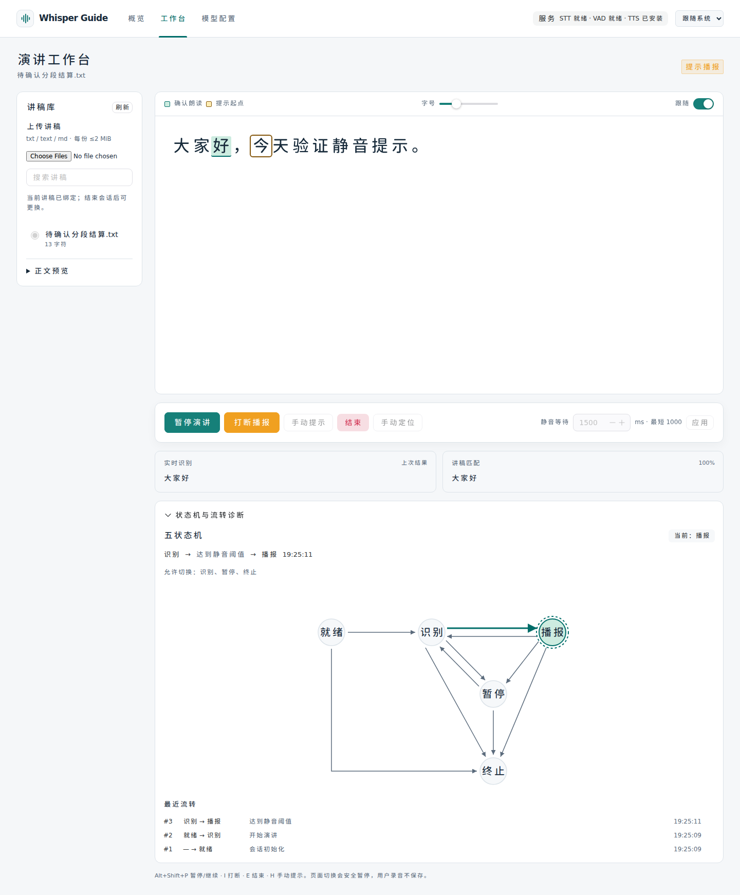

# 识别待确认、真实失配与静音结算修复

日期：2026-10-24。本轮针对“讲稿匹配提示反复切换，始终停在识别状态”进行代码检查与专项修复；不将重新安装依赖、放松讲稿匹配门槛或增加状态机状态作为解决方案。

## 截图对应的两种路径

新截图的原始识别为 final“来”，标记为“已定稿”，并出现领域层“暂时无法可靠定位讲稿”的反馈。代码与内存复现表明，这种有效转写曾真正进入 ScriptAligner 后失配：保留“我要”的已确认游标、触发一次 AC-14、禁止自动播报符合原保护规则。仅凭截图不能判断“来”来自用户、背景声音、回声还是 ASR 误转写。

另有不涉及真实失配的控制缺陷：有效 partial 已收到，却在下一次 VAD 起音重置显示时丢失，静音到期没有文本可结算；多次 VAD 起落还会把待确认的 `reliable=false` 反写成“上次可靠结果”。前端又用 `speaking` 优先切换“接收中/未匹配”文案，混淆了接收音频与对齐结论。这些问题不需要真实 ASR、云端网络或新增依赖即可复现，属于实现中的状态职责耦合，不意味着五状态结构需要重写。

## 后端变更

- 最近一次真实对齐结论与当前声音待确认分开。VAD 仍立即取消静音等待，原有暂停与手动打断规则保持，但不再覆盖上次已提交的可靠结论；真实失配会锁存，填充词及新的 VAD 活动不能将其恢复为可靠。
- SessionRuntime 用单条有界 `pending_hypothesis` 保存已接受、尚未结算的完整分段假设。VAD 可以重置实时显示，不能清掉这个提交候选。静音截止前先结算候选，再使用最新双游标决定是否进入播报。
- 同段 partial 仍按完整修订覆盖。同段修订为填充词或显式空 final 时撤回旧候选，不能用旧文字误推进游标。`None` 只表示没有新更新，不撤回已有有效候选；火山协议中省略文本的终止 ACK 仍由适配器补成当前已缓存文本，不等同于 Runtime 收到显式空 final。
- 已结算 partial 随后收到同段同文本 final 不再重复提交或重复触发语义任务；不同文本的同段修订仍可修复先前失配。旧已定稿分段不得重新作为回读处理。
- 暂停、终止、轮次失效及释放识别流会清空待提交候选和本轮显示标记。原 generation、解码轮次、连接归属、有界 PCM 队列及不落盘录音约束保留。

核心实现为[领域会话](../backend-core/app/domain/session.py)和[识别运行时](../backend-core/app/api/session.py)。未修改 STT/VAD 引擎、声学阈值、模型权重、依赖版本或单 worker 约束。

## 快照与前端含义

`alignment_status` 是对齐诊断字段，**不是第六个会话状态**：

| 值 | 含义 | 自动提示 |
|---|---|---|
| `reliable` | 当前可使用最近确认的讲稿位置 | 满足静音截止等原条件后允许 |
| `pending` | 已接收声音，等待本轮有效转写或结算 | 暂缓，不虚构新位置 |
| `mismatch` | 最近有效转写已进入对齐器且确实失配 | AC-14 保护，需有效匹配或手动定位恢复 |

`raw_transcript_is_current` 是显示新旧标记：显示重置后尚无新文本为 false，随后收到非空原始结果为 true；它不替代分段时间、声学证据或轮次校验。新 VAD 起音后尚未获得新文本时，界面可以保留历史文本供参考，但仅标记“上次结果”，不渲染 partial/final 前缀；显式空修订回退到历史文本时也标为非本轮。

真实 `mismatch` 的反馈不再被 VAD 起落覆盖成普通“正在接收”；新语音可以继续被识别，只有有效匹配或明确手动定位才解除真实失配。保留的旧匹配分在位置待确认时标为“上次匹配”，它不是当前 ASR 准确率或当前噪声质量评分。前端同时兼容缺少新增字段的旧快照，但完整诊断需要前后端同步更新。

涉及[快照类型](../frontend/src/api/session.ts)、[识别对比](../frontend/src/components/studio/TranscriptComparison.vue)和[工作台反馈](../frontend/src/views/StudioView.vue)。

## 保留的保护与未解决边界

本次没有采用“过滤后一定恢复可靠性”或“等待到期一律播报”：

- 真实 final“来”不匹配稿件时，仍保留最后可靠游标、反馈一次并保持 LISTENING，不自动跳到 PROMPTING。
- 确认 VAD 有声，但本轮没有任何有效转写、也没有可结算候选时，仍为 `pending`。无法仅凭过滤或超时证明用户没有读过新的文字，不能猜测可靠性或错误跳段。
- 连续背景声音、回声、外放音及旁人讲话仍可能触发 VAD 和 ASR；现有链路不识别主讲人身份，也没有新增降噪模型、自适应底噪或声学门槛调整。
- 设备断流仍按原超时保护暂停；不能关闭麦克风采集来模拟正常静音。

因此“有有效 partial 却丢失，导致无法静音结算”已经修复；“有声却无可用文字”仍保留安全暂缓。UI 误归类修复不等于所有抗噪、真实云端准确率或目标设备问题均已解决。当前限制和临时处理见[已知问题](known-issues.md)。

## 验证记录

新增 `tests/test_alignment_state_regressions.py` 共 18 项，覆盖多次 VAD 可靠结论、真实“来”失配、显式对齐状态、有效 partial 跨 VAD 结算、历史 raw 标记、暂停/轮次隔离、填充词和显式空 final 撤回、重复 final 去重与同段修订恢复。

| 检查 | 当前结论 | 证据 |
|---|---|---|
| 新增后端专项 | 18 项通过，包含在完整回归 | [后端日志](validation/2026-10-24-alignment-state-backend.txt) |
| 后端完整 pytest / Ruff | 563 项通过，静态与格式 60 文件通过 | [后端日志](validation/2026-10-24-alignment-state-backend.txt) |
| 前端测试 / TypeScript / 构建 | 19 Node + 72 Vitest = 91 项通过，类型与构建通过 | [前端日志](validation/2026-10-24-alignment-state-frontend.txt) |
| Chromium 端到端 | 15 项通过 | [浏览器日志](validation/2026-10-24-alignment-state-browser.txt) |
| 依赖 / 原生模型 | 依赖导入、模型加载与 100 帧数字静音通过 | [依赖日志](validation/2026-10-24-alignment-state-dependencies.txt) |
| Docker 镜像构建 | 前后端通过，新后端代码与源码哈希一致 | [构建日志](validation/2026-10-24-alignment-state-build.txt)、[镜像核对](validation/2026-10-24-alignment-state-images.json) |

后端保留一条已有 Starlette/httpx TestClient 弃用提示。只读核对默认配置为云端 `volcengine-ws`、API Key 鉴权与 `hybrid` 文本校准，语音/文本超时均为 5000 ms；未改密钥或新增真实云端推理调用。全局 ready 不证明每段音频未回退或真实识别准确率。

新浏览器用例仅在隔离测试服务器注入两阵合成 PCM（0–400 ms、800–1000 ms），模拟云端只返回 partial“大家好”而无 final。第二次已确认 VAD 后，静音截止仍对齐“大家好”、进入 PROMPTING 并收到内存音频，反馈计数一直为 0。没有降低生产门槛，测试使用 8010/5174，不连接用户 8080 或麦克风。



历史完整回归 545 项后端、87 项前端和 14 项浏览器属于瘦身阶段，不能替代本次新增代码的最终回归。测试使用内存合成音频及替身；本轮没有采集用户录音，也没有把模拟结果当成新的真实中文识别准确率或目标设备长时抗噪验收。

## 应用到运行服务

本轮已重建两份 0.1.0 镜像，但没有重启或替换用户 8080 容器。新后端约 780.36 MB、前端约 93.54 MB，新镜像后端代码哈希与源码一致。结束演讲、保留 `.env` 与 `data` 并备份后，在源码根目录切换：

```bash
docker compose up -d --no-build --pull never --force-recreate --wait --wait-timeout 180
```

刷新工作台并准备新会话，再分别验证正常朗读后静音提示、真实失配后的保护及手动定位恢复。若本轮有效识别仍为无法匹配稿件的“来”等文字，自动提示暂缓仍是预期保护；应继续检查实际识别来源、麦克风和环境声音，不能把它作为已修复路径继续强行播报。其他源码环境先执行 `docker compose --progress plain build` 再切换。本轮未导出新离线包，未替换运行容器或完成真实云端准确率/目标设备复验，不记录为这些验收已通过。
