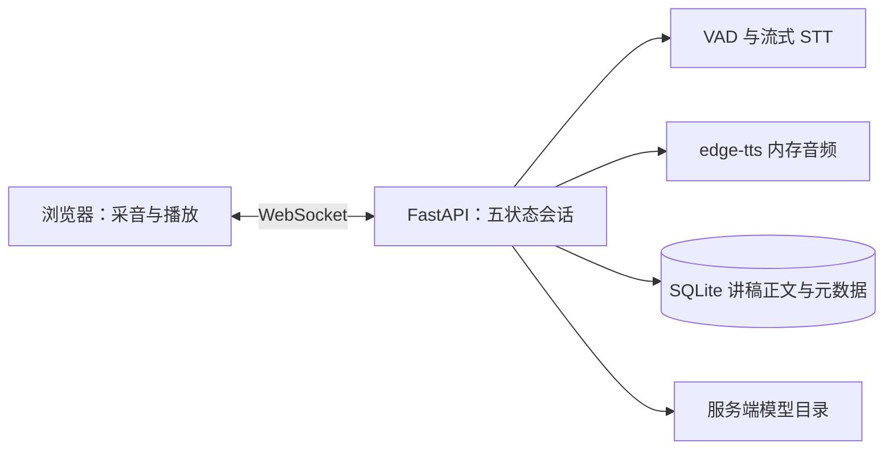

# 架构说明

浏览器以 16 kHz、单声道 PCM16 帧传输音频。服务端识别、定位讲稿、计算静音并合成提示。麦克风输入只作短时内存处理。

reading_position 由用户语音匹配推进；prompt_position 可在提示实际播完后前进。暂停、打断、终止使旧轮次结果失效。进程内管理活跃会话，因此部署单个 worker。

SQLite 保存讲稿，模型放服务端文件目录。第一版无需 Redis、MinIO、PostgreSQL 或消息队列。
