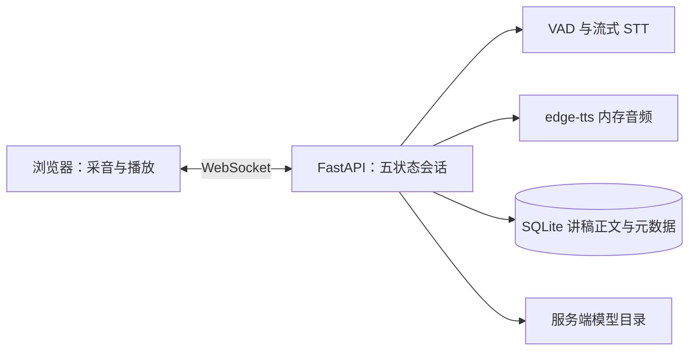

# 架构说明

## 模块边界

- `app/api/`：HTTP 路由和 WebSocket 控制器；`session.py` 负责连接归属、锁、音频有界队列和事件转发。
- `app/domain/`：五状态会话状态机、双游标、事件优先级和讲稿匹配；不依赖 FastAPI、数据库或语音引擎。
- `app/infrastructure/speech.py`：sherpa-onnx、WebRTC VAD 和 edge-tts 适配；`app/speech.py` 仅保留兼容性导出。
- `app/repositories/`：SQLite 讲稿查询和批量写入；路由层不直接拼装 SQLAlchemy 查询。
- `app/models/` 与 `app/database.py`：持久化模型和数据库连接。
- `app/config.py`：环境变量、模型目录、数据库/备份目录、默认阈值和监听地址配置。
- `frontend/src/api/`、`frontend/src/audio/`、`frontend/src/components/`：前端协议、采音/播放和页面交互。

浏览器以 16 kHz、单声道 PCM16 帧传输音频。服务端识别、定位讲稿、计算静音并合成提示。麦克风输入只作短时内存处理。

reading_position 由用户语音匹配推进；prompt_position 可在提示实际播完后前进。暂停、打断、终止使旧轮次结果失效。进程内管理活跃会话，因此部署单个 worker。

SQLite 保存讲稿，模型放服务端文件目录。第一版无需 Redis、MinIO、PostgreSQL 或消息队列。

活跃会话只保存在单个后端进程内存中，必须使用一个 Uvicorn worker；进程重启会丢失实时会话，
但不会影响 SQLite 中的讲稿。当前版本没有用户认证或讲稿权限隔离，默认仅绑定 localhost，
公网部署前需要增加 HTTPS、认证和访问控制。ASR 依赖模型目录，TTS 依赖服务器网络。

## 定位与语音 Provider

当前链路是“流式 STT → 填充词/短文本过滤 → ScriptTracker 讲稿匹配 → 双游标更新”。识别到“嗯、呃”等填充词时保持上一次可靠位置；非最终的单字假设不会立即触发定位失败。定位失败会暂停自动提示，但手动提示和重新定位仍可用。

通过 ProviderRegistry 可以注册任意云端流式 STT Provider，统一输出 RecognitionUpdate；厂商差异应隔离在网关或独立适配器中。云端 Provider 只负责识别文本，讲稿上下文对齐、重复句消歧和游标更新仍由本地 Domain/Tracker 完成；API Key 只能放在后端，且需要明确音频离开本机的隐私边界。

### ScriptAligner 参数

ScriptAligner 默认搜索当前游标前 40 个、后 80 个内容单位；综合分数使用字面连续匹配 0.35、拼音/近音匹配 0.40、游标邻近 0.18、前后方向一致性 0.07，并对超过 8 个单位的远距离跳转施加最高 0.25 的惩罚。最高分低于 0.68 时保留原可靠位置。

Provider profile 的选择由前端在会话准备时提交 stt_provider，后端校验其是否已配置和授权。前端只能选择已暴露的 Provider ID，不能修改 endpoint、access token 或其他密钥。
