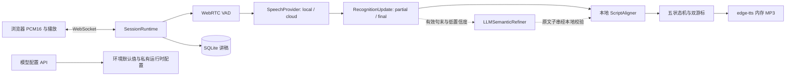

# 架构说明

## 模块边界

- `app/api/session.py`：HTTP 语音状态与 WebSocket 会话控制；管理连接归属、控制锁、音频有界队列、异步识别/合成/校准任务。
- `app/api/settings.py`：`GET/PUT /api/settings/models` 与 `POST /api/settings/models/test`；验证动态配置、固定脱敏输出、临时连通性测试。
- `app/domain/session.py`：五状态机、双游标、同批事件优先级、最近 10 次流转有界记录；不依赖 FastAPI 或语音 SDK。
- `app/domain/tracking.py`：`ScriptAligner` 与内容单位/字符偏移映射，保证英文单词和数字边界。
- `app/infrastructure/speech.py`：`LocalSherpaProvider`、通用 `HttpStreamingProvider`、VAD、`edge-tts`；厂商协议差异由网关或独立适配器转换。
- `app/infrastructure/llm.py`：基于轻量 `httpx.AsyncClient` 的 OpenAI 兼容语义校准，不绑定 STT Provider 或厂商。
- `app/config.py`：环境变量、路径、默认阈值，以及数据目录 `.model-settings.json` 原子保存/加载。
- `app/repositories/`、`app/models/`、`app/database.py`：SQLite 讲稿持久化。
- `frontend/src/api/`、`audio/`、`components/`：协议客户端、采音/播放、四个功能模块。

## 识别与讲稿约束

同一 `segment_id` 的 partial 是当前分段完整假设，覆盖前次内容，不能增量拼接。endpoint 产生 final 后重置流并递增分段号。有效人声和非填充 partial 立即取消静音倒计时或打断播报，但 partial 不正常提交 `reading_position`；静音超时进入提示之前先结算尚未定稿内容。填充词不进入定位器触发失配。

`ScriptAligner` 默认搜索游标前 40、后 80 个内容单位。打分为字面连续匹配 0.35、拼音/近音匹配 0.40、游标邻近 0.18、方向/上下文一致性 0.07；超过 8 单位远跳施加最高 0.25 惩罚，低于 0.68 保留可靠位置。`reading_position` 由用户朗读提交，`prompt_position` 在提示完成后推进。

LLM 与 STT 独立配置。`fallback` 在本地低置信度时调用，`hybrid` 在有效句末异步校准。LLM 只允许返回讲稿窗口连续 `matched_quote` 与置信度；必须通过子串、本地对齐和当前 generation/轮次令牌校验，旧返回、超时或错误不会移动游标。网络调用不占用会话控制锁，暂停、终止和新识别可使旧任务失效。

## 状态监控

状态为 `READY`、`LISTENING`、`PROMPTING`、`PAUSED`、`TERMINATED`。快照包含 `current_state`、`previous_state`、`transition_trigger`、ISO 时间 `transition_at`、最近 10 次 `transition_history` 与 `allowed_transitions`。状态机只记录实际状态变化，遥测不改变事件优先级或 generation。

前端拓扑包含：`READY → LISTENING`、`LISTENING ↔ PROMPTING`、`LISTENING → PAUSED`、`PROMPTING → PAUSED`、`PAUSED → LISTENING`，以及四个非终止状态到 `TERMINATED`。恢复暂停后的会话先回到识别，因此没有 `PAUSED → PROMPTING` 直接转换。

## 配置与数据边界

`PUT` 验证配置副本，先原子保存 `.model-settings.json` 再激活；文件权限为 `0600`，位于 SQLite 数据挂载目录。GET 只返回固定 `****` 和存在标记。空白或脱敏密钥保留原值。`POST /test` 使用临时副本，不持久化、不激活。运行时配置保留已加载本地模型，不重新加载大模型权重。

PCM、活跃会话和提示 MP3 仅在内存。SQLite 保存讲稿；`.model-settings.json` 保存配置与后端凭据，均不保存用户录音。活跃会话属于单个进程，必须 `--workers 1`；重启丢失实时会话但保留讲稿与模型配置。当前无用户认证，配置接口只能对可信访问者开放。
