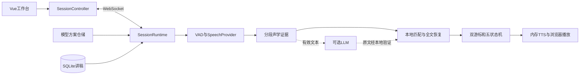

# 架构说明

核心行为见[行为规范](requirements.md)，数据契约见[接口参考](speech-provider-interface.md)，使用与限制见[使用指南](user-guide.md)。

## 模块与数据流

apps包含独立的Vue前端和FastAPI后端，应用分别安装依赖和运行。根deploy负责Nginx、打包与部署，根scripts负责运维工具；data与备份、模型资源、release产物不属于业务源码。目录重组不改变容器内/app/backend-core路径、服务/镜像名或持久卷挂载。

| 文件/目录 | 职责 |
|---|---|
| apps/backend-core/app/api/session.py | WebSocket、连接归属、音频队列、识别/合成任务与快照 |
| apps/backend-core/app/domain/session.py | 五状态、双游标、对齐证据、事件优先级与最近10条流转 |
| apps/backend-core/app/domain/tracking.py | 原文单位边界、附近评分、全文字面/拼音trigram索引 |
| apps/backend-core/app/infrastructure/audio_evidence.py | 有界声学特征、噪声底与分段证据，不保存PCM |
| apps/backend-core/app/infrastructure/speech.py | 本地/HTTP识别、VAD、热备回退、内存TTS |
| apps/backend-core/app/infrastructure/speech_websocket.py / speech_protocols.py | 有界传输与厂商协议适配 |
| apps/backend-core/app/infrastructure/llm.py / model_catalog.py | 语义原文建议、模型目录与受控失败 |
| apps/backend-core/app/repositories/ | SQLite讲稿、私有版本化模型方案 |
| apps/frontend/src/services/sessionController.ts | 应用级唯一采音、连接与播放器所有者 |
| apps/frontend/src/stores/ | 可展示快照、讲稿、模型方案与主题 |
| apps/frontend/src/views/ / components/ | 三视图、讲稿显示、模型表单与诊断 |
| apps/frontend/src/audio/ / public/pcm-capture.js | PCM采集/重采样、播放与取消令牌 |

## 声音、识别与位置

浏览器请求回声消除、降噪和自动增益，支持时请求voiceIsolation；可选getSettings仅在内存保留实际处理设置，不存设备标识。PCM为16kHz单声道PCM16，20ms一帧。前端只在stt_ready=true后启用传音和audio_ready确认；同代重复快照与同值enabled不重复开流或清空残帧，旧采集回调和HMR资源失效。

采集图优先匹配音轨getSettings().sampleRate，不再强制16kHz；context/source采样率不兼容时释放失败图后有界回退（最多3次），由worklet按实际图率重采样、合并多声道。后端会话设置仅接受16000Hz，避免与固定PCM协议不符。worklet加载及图恢复等待最多5秒；轨道断开/mute、处理器错误和图中断使会话暂停，继续时重建采集。停止即清除正在打开的Promise引用，旧完成不能占用新打开操作。

输出使用独立的默认采样率Context，开始/继续在用户手势内发起解锁，失败不阻塞识别。播放器恢复最多5秒、解码最多15秒，播放按音频时长加2秒设置失败看门狗；正常onended之外不产生成功通知。暂停/中断/关闭及旧代结果不能推进提示起点。最近播放原因和采样率元数据仅用于内存诊断，浏览器ended不代表硬件扬声器可听。

AudioEvidence在流内累计音频时钟，不保留PCM。真实VAD阳性需AC RMS至少16、持续60ms；能量fallback带独立来源标记，短期起音受保护，但平稳噪声可被底噪学习撤回；纯能量兜底需至少64、持续80ms。连续600ms、VAD阴性且能量相对稳定时学习底噪，纯能量门槛收紧为至少底噪1.5倍；VAD轻声通道不变。

只保留30秒/最多1500帧标量与32个已授权分段。迟到final可包含原声音锚点和尾静音，但不能直接将授权搬到后续静音。底噪学习可撤回早期纯能量证据，Runtime同步撤回pending、临时位置和依赖的模型历史。确认位置若依赖被撤回的证据，降为不可靠，保留偏移作历史，不猜测回滚。

本地解码保留greedy_search和INT8 encoder/joiner，FP32 decoder优先；模型升级脚本和Docker输入采用相同选重。基础识别层只整理空白，不删除真实重字。讲稿依据校准仅用于aligned字段，raw直接反映模型。

同段partial为完整修订，覆盖显示。两次相同或保持300ms可显示临时位置；final或静音截止结算才提交确认位置。pending假设独立于VAD显示，已有有效partial跨VAD起落仍可结算。空final/filler撤回同段假设，None不撤回；重复final不重复提交。只有声音无可用文字仍pending。

## 本地定位与自动恢复

正常匹配搜索游标前40/后80内容单位，并按片段长度调整。评分组合字面0.35、拼音0.40、邻近0.18和上下文0.07；远跳有最高0.25惩罚，可靠门槛0.68。用候选完整范围计算距离，连续长句不因句末较远受罚。

模糊比较最多末64单位；更长片段先验证附近省略前缀，单段上限256单位。英文单词、数字和原文偏移保持完整。

失锁后通过预建全文规范字/拼音trigram索引查询强锚点。附近唯一正文可恢复；远处位置须两份独立、推进连续且各不少于6单位的证据。多处重复等后文消歧，不凭离旧游标近解除失锁；过多重复候选保守等待。

同段partial/final、重复文字和LLM纠错不是独立第二证据。证据身份含generation与段号，重建流清暂定链；确认远跳记录前后来源，任一来源撤回都取消可靠性。可信的短失配不能按文本长度猜成噪声；超时辅助只使用保存起点，不伪造定位恢复。

reading_position仅表示确认用户位置；prompt_position为下一提示起点。句中保留完整已读单位，分段末尾跳到下一片段，全文读完不重复末字。临时位置不移动双游标、不触发确认位置跟随；进度模式可用已验证的稳定向前partial更新辅助计时。

## 进度超时辅助

五个主状态不变。会话选项在静音模式外提供progress模式，进度计时从实际收音就绪建立；记录最后有效向前进展及来源，VAD、无关转写和重复假设不延长计时。稳定partial必须有当前分段声学依据且只刷新向前观察水位，不能直接提交确认游标；撤回与流generation仍约束其有效性。

Runtime在音频到达、队列清空且无推理在途后判断进度到期；progress可越过持续speaking/pending_voice门控，但不能越过断流、未就绪、积压及故障。到期先结算已接受草稿，确有进度则重启等待，无进度才触发提示。LLM不参与决定deadline，旧识别/合成仍由generation作废。

progress提示有未撤回可靠锚点时取其下一完整内容单位，未确认则取保存提示位置；不改reading_position。默认自动提示一次后撤销自动续播资格，直到新有效进度或人工重新等待/继续；continuous_prompt显式开启才每次完整等待后代读。silence保留原分段循环行为。postpone_prompt只重启等待，不改变对齐结论。

移动界面采用适应视口的讲稿/设置/诊断面板、触摸操作和安全区；后台/pagehide触发控制器暂停，回前台不自动恢复，视图折叠不创建第二个音频或WebSocket资源所有者。

## LLM与并发边界

可选fallback只在本地不可靠时调用，hybrid也校准有效句末；不足6单位不请求。失锁上下文用全文trigram召回最多4段原文、合计4096字符。模型只给原文quote与置信度，需通过字面/拼音支持、子串、全稿歧义与领域恢复规则，不能直接给游标。

请求绑定结算版本、generation与stream_epoch。新partial不反复取消请求；最多追赶4条后续结算证据，在会话副本验证后一次性提交。人工定位、暂停、播报、同段修订/撤回、流重建使旧返回失效。旧结论不能替新VAD活动或待结算partial放行，当前活动仍pending。

本地推理和外部网络不占用会话控制锁；控制与游标提交串行。云端ready由握手与初始化发送完成决定，可取消后台等待；未就绪不接PCM、不消耗静音预算，暂停/重建流使旧ready失效。传输只接受确认人声通知启动结果看门狗，删除独立的原始RMS触发路径；网络/发送/缓冲保护保留。回退保存受控标量诊断和配置超时，不保存上游异常正文。浏览器20ms常规采音使用最多50项且真实PCM最多1秒的Runtime队列；实际本地识别或回退后的本地适配器可在一次线程调用中无损处理最多5包/100ms，逐包声学证据和partial/final顺序保留，不用丢音或扩大队列掩盖性能不足；云端活跃时保持逐包observe→notify→accept避免重启旧声音看门狗；相同稳定partial只计算一次临时对齐；云端每200ms发送，传输层音频最多1秒、结果32项、最多4个活跃线程。发送周期包括send耗时，真实慢链路或溢出保护性回退本地。

## 生命周期与持久化

主状态仅READY/LISTENING/PROMPTING/PAUSED/TERMINATED。alignment_status、recovery_status、说话与静音均为诊断或内部信息。结束/暂停/开口等优先级见行为规范，旧generation和旧连接不能提交。

静音到期先结算有效草稿，位置仍pending/mismatch时用保存prompt_position触发recognition_wait_timeout，明确反馈但不更改reading_position或reliable。原始音频未到、排队音频未处理、真实人声、断流、末尾仍不强行播报。每秒最多一个audio_diagnostics小事件包含计时、排队时长和推理成本，不重复序列化稿件；客户端按session_id/generation接收。

离开工作台立即停采音/播放并请求暂停；返回和断线恢复都由用户主动继续。播放完成通知只推进提示位置。5秒无PCM为设备断流，不能当静音提示。

实时会话由单个后端进程持有，必须一个Uvicorn worker。服务重启丢失会话，SQLite讲稿与私有模型方案保留。

模型方案编辑和实际生效快照分开；准备会话、激活和讲稿删除使用同一锁。prepare在锁内查稿并登记会话；DELETE在锁内查稿、检查所有未终止会话并提交删除，没有await窗口。registry初始化与增删也受该锁保护，避免并发删除后登记旧稿或遍历字典改变。任何未终止会话阻止激活。仓储原子保存、版本冲突检查、0600权限；旧配置首次迁移后新仓储优先，损坏不静默覆盖。

音频队列、录音与TTS仅内存；云端ASR发送音频，LLM发送原文窗口和转写。当前没有身份/讲稿隔离，需可信访问或部署外部认证层。
