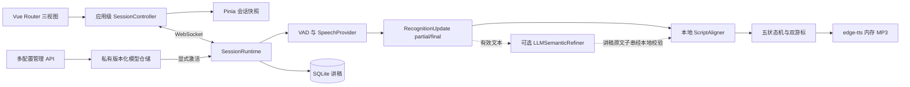

# 架构说明

## 模块与数据流

后端边界：

| 模块 | 职责 |
|---|---|
| `app/api/session.py` | WebSocket 命令、归属校验、音频有界队列、识别与合成任务、会话快照 |
| `app/api/recovery.py` | 断线会话的只读元数据列表和用户明确结束操作 |
| `app/api/settings.py` | 多方案 CRUD、复制、测试、激活、旧接口兼容与固定密钥脱敏 |
| `app/domain/session.py` | 五状态机、双游标、批事件优先级、最近 10 条流转记录 |
| `app/domain/tracking.py` | ScriptAligner、讲稿内容单位、字符偏移、英文数字完整边界 |
| `app/infrastructure/speech.py` | 本地/通用云端 STT、VAD、内存 TTS、失败回退 |
| `app/infrastructure/llm.py` | 轻量 OpenAI 兼容文本校准，厂商无关 |
| `app/repositories/model_configs.py` | 模型方案草稿、生效快照、修订号、锁和原子私有文件保存 |
| `app/repositories/scripts.py`、`app/models/` | SQLite 讲稿持久化 |
| `app/config.py` | 环境默认值、路径及旧单套配置兼容读取 |

前端边界：

- `layouts/AppLayout.vue`：统一导航、主题选择、服务入口和未结束会话提示。
- `views/`：概览 `/`、工作台 `/studio`、模型管理 `/settings/models`。
- `stores/`：可展示的会话快照、讲稿、健康状态、配置和主题；不保存音频帧或 API 密钥。
- `services/sessionController.ts`：应用级唯一麦克风、WebSocket 与播放器资源所有者；视图不再分别创建它们。
- `services/healthMonitor.ts`：可见页面每约 10 秒检查服务状态，隐藏时停止发起轮询；不自动产生付费模型或 TTS 探测。
- `api/`、`audio/`：协议客户端与采集/播放基础设施；保留取消令牌和连接归属保护。
- `components/studio/`：讲稿高亮、操作区、raw/final 对比与折叠状态机诊断。

## 流式识别与位置提交

VAD 当前用于人声信号、静音计时和云端超时，不等同于完整声学降噪；非人声帧仍保持流式传输，原始 ASR 可能产生误转写。云端音频每块 200 ms，发送周期从实际发送开始计算，包含发送耗时；持续链路慢于实时音频时仍由一秒有界缓冲触发保护回退。

同一 `segment_id` 的 partial 是分段的完整假设，覆盖前次文本；endpoint 产生 final 后重置流并递增分段号。VAD 有效人声或有效 partial 立即取消静音计时或打断提示，但 partial 不正常提交 `reading_position`。静音截止前结算尚未定稿文本，然后决定提示起点。填充词不进入定位器造成失配。

`ScriptAligner` 默认搜索游标前 40、后 80 个内容单位。评分为字面连续匹配 0.35、拼音/近音匹配 0.40、游标邻近 0.18、方向/上下文一致性 0.07；邻近距离根据候选完整范围与当前游标的关系计算，覆盖游标或从下一单位顺延的长句不因句末较远而受罚；真实远跳超过 8 单位施加最高 0.25 惩罚，低于 0.68 保留最后可靠位置。超过 64 单位的识别段先在附近验证其省略前缀原文，只有证据成立才扩到末尾的 64 单位进行模糊比较；单段最大 256 单位，超限保守不提交，避免扩大控制锁内计算。`reading_position` 由朗读提交，`prompt_position` 在提示完成后推进。

LLM `fallback` 用于本地低分结果，`hybrid` 在有效句末异步校准。输出只能为讲稿窗口中的连续 `matched_quote` 与置信度，必须通过本地子串、对齐、generation 和转写修订校验。网络工作不占用会话控制锁；暂停、终止及新识别会使旧返回失效。云端不能直接指定两个游标。

## 路由与会话生命周期

工作台离开守卫立即停止本地采集/播放，并请求服务端暂停活动会话。守卫等待确认；失败则断开连接并明确显示连接中断，不能把本地停止伪装成服务端已确认。返回工作台不会自动启用麦克风，由用户点击继续。

刷新浏览器后可根据保留的会话标识重新连接；遗留断线会话可由恢复入口列出并明确结束。恢复列表只包含 ID、讲稿名称、状态和配置名称，不返回讲稿正文或识别文本。结束接口先等待运行时控制锁，再复查连接归属和注册表身份；已被其他连接接管的会话返回 409。终止通过领域 `end` 事件增加轮次，取消合成/语义任务、关闭流并清空内存音频队列。

后端重启会丢失活跃会话，前端必须重新准备。运行时始终单进程、单 Uvicorn worker。

## 多模型方案与并发

方案草稿和生效快照分开保存：编辑或测试方案不会更新当前运行设置；显式激活才更新生效版本。会话准备时记录配置 ID、名称、版本及参数快照。任何未终止会话，包括 READY 与 PAUSED，都阻止配置激活；服务器返回 `409 SESSION_ACTIVE`。

仓储使用同一个配置锁串行化保存和激活；会话准备在共享锁内捕获配置并登记运行时，避免激活与准备竞争。方案更新需要修订号，冲突返回 `409 REVISION_CONFLICT`。前端禁用只用于交互，后端仍执行保护。

`WHISPER_GUIDE_DATA_DIR/.model-configs.json` 保存方案和生效快照，使用临时文件、fsync、原子替换和 `0600`。加载旧 `.model-settings.json` 后生成“现有配置”及无凭据的“默认本地离线模式”；新仓储存在时其生效快照优先。旧 PUT 接口继续显式保存并激活，写入失败回滚兼容文件，避免失败操作在重启后生效。

凭据只由密码输入向后端提交，GET 恒定返回 `****` 与存在标记；空白保留、明确清除才删除。复制不携带凭据。私有文件损坏时显示仓储不可用，不把异常文件静默覆盖。

## 状态与隐私

五状态保持 `READY`、`LISTENING`、`PROMPTING`、`PAUSED`、`TERMINATED`，共 10 条合法连线。快照增加上一状态、触发原因、ISO 时间、允许目标和最多 10 条历史；遥测不改变事件优先级。PAUSED 恢复先进入 LISTENING，不直接恢复旧播报。

PCM 队列与提示 MP3 均不写入 SQLite、文件或日志。SQLite 保存讲稿，私有 JSON 保存模型凭据。云端 STT 需要音频授权和可用密钥；语义 LLM 发送讲稿窗口和文本，不发送录音。当前无用户身份隔离，配置与恢复接口只面向可信访问者。
