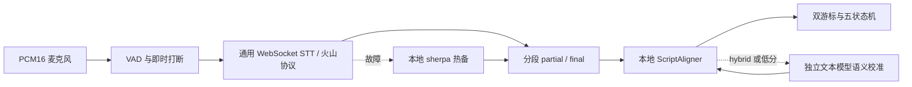

# 2026-10-24 原生流式语音与双云配置

## 本轮交付

在保留通用 HTTP 网关和本地 sherpa 的基础上，新增通用 `WebSocketStreamingProvider` 传输策略与 `VolcengineSpeechProtocol` 协议适配器。火山鉴权、二进制帧与结果解析都在基础设施层；领域层继续只消费 `RecognitionUpdate`，云端不能直接改变游标。



## 配置步骤

先更新镜像，打开 `/settings/models`，新建或编辑方案：

| 语音识别项 | 填写方式 |
|---|---|
| STT Provider | 云端语音接口 |
| 语音接口协议 | 火山语音 WebSocket |
| 推荐设置 | 点击“填入推荐设置”，填入优化双向接口与 ASR 2.0 小时制资源 |
| Endpoint | `wss://openspeech.bytedance.com/api/v3/sauc/bigmodel_async` |
| Resource ID | `volc.seedasr.sauc.duration`，或改成语音控制台已开通的小时/并发资源 |
| 鉴权 | 新版语音 API Key；旧账户也支持 App ID + Access Token |
| 语音请求超时 | 默认 5000 ms，范围 200–30000 ms，与文本 LLM 超时独立 |
| 二遍复核 | 默认开启，仅优化 `bigmodel_async` 接口生效 |
| 隐私授权 | 明确勾选后才允许发送麦克风片段 |

新版语音 API Key 无需 App ID。现有后端字段 `cloud_stt_access_token` 保存本方案的语音凭据，依据鉴权模式发送为 API Key 或 Access Token；不会自动使用 `llm_api_key`。密码留空保留原凭据，复制方案不复制秘密。

“大模型语义对齐”独立选择 `hybrid`，填写方舟 Base URL、方舟文本模型 API Key，通过“获取模型列表”选择账号实际可调用的 Seed 模型 ID。示例别名不能替代调用示例或列表返回的真实 ID。分别测试语音和文本，再保存、结束所有未终止会话并激活；新会话使用新版本。

## 协议与生命周期

- PCM16 为 16 kHz、单声道，后台每 200 ms 发送 6400 字节；二进制头、长度、可选序号使用大端，JSON 与音频按协议 gzip 编码。
- `result_type=single` 限制累计历史响应；兼容服务端 full 快照。同段 partial 是完整修订并覆盖，`definite=true` 只定稿该段、递增 ID，不关闭整条连接。仅负包标识流结束。
- 通过时间/序号水位过滤服务端历史分句，合法的新时间段重复朗读仍可提交。600 ms 端点窗口配合现有静音前强制结算，不改五状态和双游标规则。
- 每条传输最多 1 秒待发 PCM、32 条待消费更新，WebSocket 传输最多 4 个活跃线程；服务器帧最多 1 MiB，解压 JSON 最多 256 KiB。积压、业务错误、超时或断网触发热备本地。
- 连接和发送受独立 STT 超时约束；有声数据发出后启动结果期限，异步接口在静音期间不返回变化包不会被误判超时。暂停/终止立即清空本地队列并取消网络工作，后台尝试结束包与限时关闭，控制操作不等待云端定稿。
- 修复回退时重播陈旧本地结果的风险：缓存必须晚于最近云端 final 的音频帧水位，才可作为新分段接管，避免伪造 AC-13 回读。
- 会话快照新增 `stt_provider_active` / `stt_fallback`；即使没有新文字也同步来源变化。前端明确显示“云端识别已回退本地”，区分配置能力与实际识别源。
- 公网要求 WSS，仅环回允许 WS；不跟随握手重定向。专用 WebSocket 日志器禁用，避免全局 DEBUG 将音频二进制帧或鉴权头写入日志。所有录音只存在有界内存，不新增文件落盘。

## 连通性测试边界

语音测试使用当前草稿和独立凭据，不保存、不激活、不调用本地回退。发送短静音、结束包并等待终止响应，不能只凭初始 ACK 就成功。只有已知空音频码 `45000002` 可明确标注为“鉴权与协议可达、仍需工作台朗读验证”；其他业务错误、HTTP 错误和超时仍失败，原始消息和凭据不回显。

本轮使用本地模拟 WebSocket 服务及合成麦克风完成自动化，**未使用真实火山语音账号或真实录音做线上 ASR 准确率验收**。语音控制台资源权限、真实中文识别质量和目标设备需在配置有效语音凭据后单独验收；此前本地 sherpa 和方舟模型目录测试不替代本次云端验收。

## 验证结果

| 检查 | 本轮结果 | 日志 |
|---|---|---|
| 后端 pytest | **392 passed**，原有回归加 117 项协议/传输/配置/回退用例 | [backend](validation/2026-10-24-cloud-asr-backend.txt) |
| Ruff 静态/格式 | 全通过，50 个文件格式合规 | 同上 |
| 前端测试 | **19 项 Node + 39 项 Vitest** 全通过 | [frontend](validation/2026-10-24-cloud-asr-frontend.txt) |
| TypeScript / 生产构建 | 全通过，模型页 JS 31.06 kB（gzip 10.23 kB） | 同上 |
| 浏览器端到端 | **9 passed**，新增双云识别与错误凭据本地回退；6000 字讲稿暂停切页 288 ms | [browser](validation/2026-10-24-cloud-asr-browser.txt) |
| 容器导入与依赖冒烟 | 现有镜像只读挂载最终源码，应用/接口导入、本地模型就绪、websockets 17.3 通过 | [container](validation/2026-10-24-cloud-asr-container.txt) |
| Compose | 新 5 项环境变量映射、`docker compose config --quiet` 通过 | 同上 |

浏览器验证实际经过本地 WebSocket 二进制连接：配置独立语音与文本凭据、协议探测、保存/激活、识别“大甲好”、本地讲稿对齐为“大家好”、暂停与终止；错误凭据模拟 HTTP 403 后仍保持演讲并显示本地回退。服务器测试覆盖 ACK 后业务错误、空音频、禁止重定向、缓冲上限、无变化静音、语音超时、快速关闭和无新文本的状态同步。

仅将已有传递依赖 `websockets` 显式列为生产依赖并冻结锁，未新增大型 SDK 或推理框架。保留第三方 Starlette/httpx 的 1 条弃用警告，测试无失败。原 8080 容器保持运行，未重新构建或导出镜像；临时容器和测试文件已清理。

[双云配置截图](screenshots/cloud-speech-2026-10-24/configuration.png) 使用模拟账号和地址，不包含真实凭据。字段契约见 [Provider 接口](speech-provider-interface.md#原生-websocket-流式-asr)。

## 应用更新

结束当前演讲后执行：

```bash
cd /home/timeleafing/projects/whisper-guide
docker compose build && docker compose up -d --force-recreate --wait --wait-timeout 180
```

在页面输入语音服务的有效 Key 和资源、独立配置方舟文本模型，分别测试通过后保存和激活，再开始新会话。
