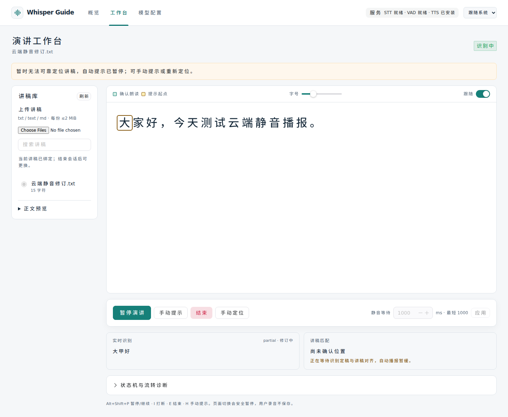
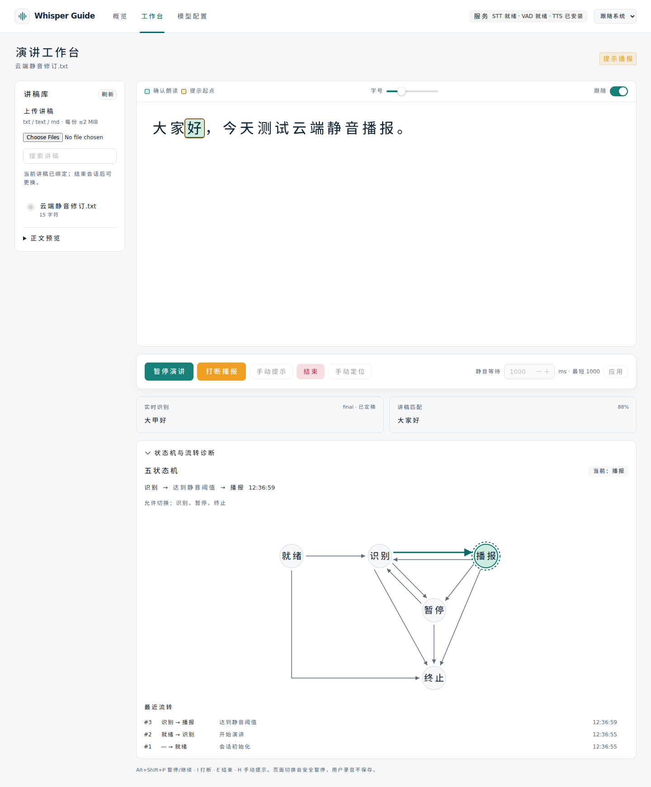

# 云端识别静音等待与模型配置排查（2026-10-24）

## 结论

当前生效的 doubao 方案语音鉴权与协议正常，本次没有复现此前的 HTTP 401。真实云端 STT 连通测试通过（610 ms）；使用相同配置的新建独立内存会话，连续输入静音在 1009 ms 进入播报，并由真实 edge-tts 返回内存音频。此测试没有连接或中断用户正在使用的会话。

发现并修复了会导致间歇等待的代码缺陷，同时确认方舟文本模型的 5000 ms 超时不足。没有读取或保存用户麦克风录音，没有回显密钥，也没有修改/激活用户方案。运行中的 8080 镜像需要重新构建后才会包含本次修复。

## 已修复的缺陷

1. **同段 partial 修订不能再次结算。** 原实现只记住已结算的 segment_id。错误 partial 第一次静音到期定位失败后，即使云端把同段修订为正确文字，后续到期仍跳过对齐，导致位置一直不可靠。现在用 `(segment_id, text)` 去重，同一假设不重复提交，修订文本允许再次由 ScriptAligner 校验。修复前专项真实失败，修复后自动进入播报。
2. **VAD 清临时状态后，迟到旧 final 被当作新段。** 新增本轮已 final 的段编号水位；瞬时 VAD 开始不会清除此水位，换轮关闭流才清理。旧 final 不能伪造回读，新段合法回读仍通过 AC-13 测试。
3. **弱人声触发了会话 VAD，却没有启动云端无结果超时。** 原云端传输仅以较高 RMS 判断是否需等待结果；它与 WebRTC VAD 可以不一致。现在将会话使用的同一 VAD 信号通知云端结果时限，弱声音也会触发有界等待与失败回退；持续纯静音仍不会误触发无结果超时。
4. **AC-14 反馈在前端未显示。** 后端已发送“无法可靠定位，自动提示已暂停”，前端只存储 notice 没有渲染。现在工作台明显展示当前有效反馈，识别对比区区分正在收音、无有效文字、等待定稿与定位失败；位置恢复后隐藏旧警告，避免下一段再次显示陈旧反馈。

仍保留五状态、双游标、同批优先级、锁内轮次与 WebSocket 归属校验、不可靠位置不自动播报、有界内存音频和单 worker 约束。

## 当前配置的实际检查

| 项目 | 实测 | 结论 |
|---|---|---|
| STT | `cloud`、`volcengine-ws`、新版语音 API Key、ASR 2.0 小时制、5000 ms | 握手和协议响应通过，610 ms |
| 本地能力 | STT/VAD/TTS 均 ready | 具备本地热备与 TTS 依赖 |
| 方舟文本 | `doubao-seed-2-1-lite-260915`、`fallback`、5000 ms | 5001 ms 超时 |
| 方舟临时探测 | 同一模型/凭据，临时 15000 ms，不保存 | 14952 ms 请求成功；权限与模型可调用，响应慢 |
| 真实云端静音 | 独立会话，1000 ms 静音阈值 | 1009 ms 进入 PROMPTING；reading_position 仍 null |
| 真实 TTS | 内存合成提示 | 收到音频消息，无服务暂停 |

完整脱敏结果见[现场检查记录](validation/2026-10-24-cloud-silence-live.txt)。语音和文本测试分别发起，不保存、激活方案，不修改已运行会话。

如果希望当前文本模型参与低分兜底，可在结束会话后，将“请求超时”临时设为 20000 ms，先测试，再决定保存/激活。实测成功的 14.95 秒只是一次采样，不是延迟保证；较长超时也不会使模型更快，应按实时性需求选用响应更快的模型或非深度思考模式。项目当前未提供独立 thinking 参数开关，本轮没有新增厂商绑定或猜测模型默认模式。

文本 LLM 请求始终在后台执行，超时保留本地结果，不持有音频控制锁。低分片段在本地仍不可靠、云端复核又超时时，系统继续保护游标，用户需继续朗读或手动定位；不能用忽略 AC-14 的方式强行播报旧位置。“静音等待”与两个云端“请求超时”是不同参数。

## 正常不自动播报的情形

- VAD 仍检测到人声，包括环境噪音或扬声器回声：静音尚未开始。
- 尚无可定位的有效识别文本，或读的内容不在讲稿窗口内：继续显示识别，但自动提示暂缓，提供可见说明。
- 云端延迟修订仍在到达：新有效假设可能重新启动等待，文字到达时间与真实停声时间不完全相同。
- 麦克风无帧超过 5 秒：应暂停为设备断流，不当作正常静音。
- 提示游标已到讲稿末尾：没有下一段可播报。

本轮不能据此断言用户每次卡住的现场都属于同一个分支；没有接管其 WebSocket 或采集其麦克风。已有错误路径均通过独立回归复现并修复。

## 验证与截图

| 检查 | 结果 | 日志 |
|---|---|---|
| Ruff 静态/格式 | 通过，52 个文件格式合规 | [backend](validation/2026-10-24-cloud-silence-backend.txt) |
| pytest | 409 passed；1 条既有第三方弃用提示 | 同上 |
| 前端 Node / Vitest | 19 + 57 = 76 项通过 | [frontend](validation/2026-10-24-cloud-silence-frontend.txt) |
| TypeScript / 生产构建 | 通过 | 同上 |
| Chromium E2E | 11 passed | [browser](validation/2026-10-24-cloud-silence-browser.txt) |
| Compose 配置解析 | 通过 | `docker compose config --quiet` |

新增 7 项运行时回归覆盖同段修订、相同文本只结算一次、失配不乱跳/不反复反馈、迟到旧 final、新段合法回读与旧轮丢弃；2 项低音量 VAD 超时测试覆盖直连和带本地热备；5 项前端测试覆盖有效警告和恢复。新增浏览器测试通过本地 WebSocket 火山协议模拟服务重放“错误 partial → 静音失配 → 同段正确 partial → 静音自动对齐播报”，验证游标停留、恢复到“大家好”、警告清理和内存提示音频。





浏览器使用合成音频与模拟云端，真实配置检查仅使用数字静音与最小文本探测；未重新验收真人中文识别准确率、真实扬声器播放或长时设备噪音。没有下载模型、安装依赖、打包镜像或导出发布包。

## 应用更新

结束当前演讲后在项目根目录执行：

```bash
cd /home/timeleafing/projects/whisper-guide
docker compose build && docker compose up -d --force-recreate --wait --wait-timeout 180
```

刷新工作台，再创建会话。先保持麦克风开启并安静，确认首次提示；再朗读讲稿，观察原始识别、匹配结果和等待说明。文本模型超时需单独在模型页测试，保存与激活互不替代。
