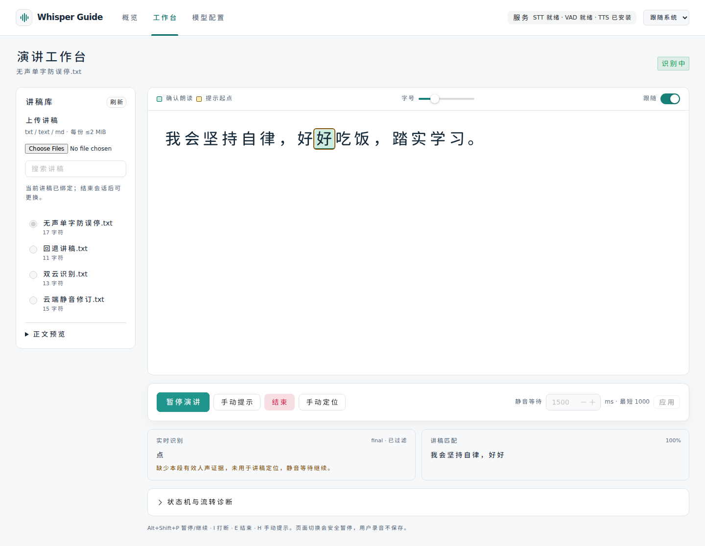
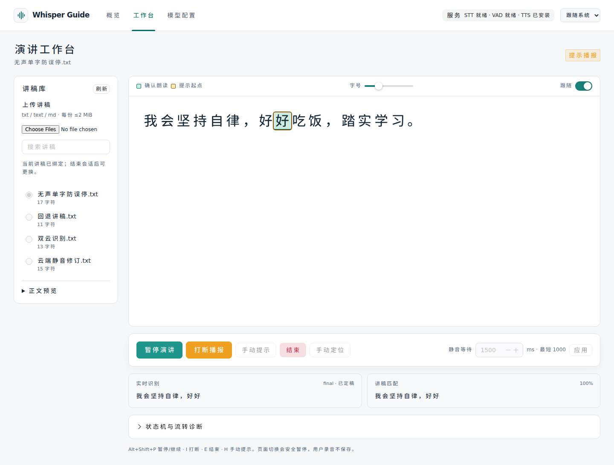

# 无声识别结果防误停（2026-10-24）

## 现场线索与修复目标

截图的已对齐讲稿为“我会坚持自律，好好”，随后原始识别显示孤立的 final“点”，位置被标为不可靠，触发 AC-14 并停止自动提示。仅凭截图无法判断该字来自底噪、回声、真实声音还是模型误转写；本轮目标是让缺少本段有效声学证据的识别结果不能推翻可靠位置，也不能打断原静音计时。

不会把“点”列为填充词/黑名单，不会强行把所有不可靠位置恢复为可靠。真实朗读“点”仍可对齐，真实脱稿仍受 AC-14 保护。

## 实现

- 新增 `app/infrastructure/audio_evidence.py`。PCM 按最多 20 ms 分块提取去直流 AC RMS/VAD 标量；原始 PCM 不进入证据历史。最多保留 30 秒/1500 个特征区间、32 个已认可分段锁存及少量音频水位。
- 原始 VAD 与 AC RMS≥16 连续 60 ms 才作为确认人声；前 20/40 ms 的待确认期会暂缓到期检查，短促点击结束后继续原有计时，不先破坏位置可靠性。零值、直流和极低幅噪声不成为人声。
- VAD 漏检时，连续 80 ms、AC RMS≥64 可以支持有效识别文本，不能仅凭这类能量自动触发 speech_start。上述数值是保守起点，不能保证区分所有高能噪声或极弱人声。
- 所有 PCM 仍发送给 ASR，保留端点所需尾部静音；本轮做接收侧声学证据门控，不采用激进切帧或新增降噪模型。
- `RecognitionUpdate` 与 `ProtocolTranscript` 末尾增加可选 `start_ms/end_ms`，已有位置参数保持兼容。火山协议保留 utterance 时间及空终止 ACK 的当前段时间；同文本时间修订不会被吞掉。原生 sherpa 也提供持续连接的累计 PCM 时间，endpoint/reset 只移动段起点、不归零连接时钟。回退时仅保留明确使用连接时钟的原生本地时间；自定义本地相对时间仍清除，避免时钟混用。空 endpoint 不覆盖热备有效缓存。
- 完整双时间边界按实际 PCM 时钟对应区间检查，不允许先前句子的声音授权后面的纯静音文字。不完整/缺失时间使用近期活动及水位；连续有声时新段必须有新增声学证据，已静音时不能复用旧活动。已认可同段的迟到 partial/final 不要求返回时仍有声；前句 final 也不消费后句已发送的音频。
- Runtime 在更新临时文本、轮次修订、speech_start、游标、AC-14 或 LLM 任务之前过滤无证据结果。被过滤文本仅单条展示于内存诊断及原始识别区；不污染已接受文本、不取消静音时钟、不改可靠性。后续有效识别清除过滤标记，换轮完整重置证据。
- 声音通知从原始 is_speech 判断移到 Runtime 确认人声后，避免仅凭 VAD 假阳性提前启动云端结果期限；传输层原有高能音频超时保护仍保留。
- 前端增加“已过滤”标签及原因，和讲稿匹配分开显示。原本已不可靠的位置不会因为过滤另一条噪声而被假称恢复自动播报。

## 验证结果

前次自动审批服务中断后，本轮已恢复执行并完成全量回归。原 8080 容器、用户讲稿、凭据和生效模型配置未被替换。

| 检查 | 本轮结果 | 日志 |
|---|---|---|
| Ruff 静态/格式 | 通过，58 个文件格式合规 | [backend](validation/2026-10-24-noise-guard-backend.txt) |
| pytest | 479 passed；1 条既有第三方 TestClient 弃用提示 | 同上 |
| 前端 Node / Vitest | 19 + 60 = 79 项通过 | [frontend](validation/2026-10-24-noise-guard-frontend.txt) |
| TypeScript / 生产构建 | 通过 | 同上 |
| Chromium E2E | 12 passed | [browser](validation/2026-10-24-noise-guard-browser.txt) |
| 真实本地模型数字静音 | STT/VAD/TTS ready；0 确认人声、0 有效文字 | [native STT](validation/2026-10-24-noise-guard-native-stt.txt) |
| Compose 解析 / 差异空白检查 | 通过 | `docker compose config --quiet` / `git diff --check` |

新增 28 项声学证据、15 项 Runtime 抗噪、时间传播/回退以及原生连接时钟回归；其中“20/40 ms 起音后无帧”仍按 5 秒断流保护暂停，待确认人声不会屏蔽设备故障处理。5 秒云端超时取到本地热备有效 final 时，保留可信区间而正常接管；后续无声 final“点”仍被过滤，空 endpoint 不覆盖热备结果。

旧部分测试用全零 PCM 伪造有声识别，与声学门控矛盾。现将有声场景换为合成交流波形，保持静音场景的零 PCM 和原有状态机断言。浏览器朗读场景也显式注入 600 ms、220 Hz 的有限合成波形，之后持续静音；没有降低生产门槛以迁就旧替身。

真实 sherpa-onnx / WebRTC VAD 输入 300 帧数字静音（每帧 20 ms，共 6000 ms 音频）：0 帧确认人声、0 条有效转写，端点区间为 `[0,2660]`、`[2660,5220]`，连接时钟没有随 reset 归零。因环境没有 ffmpeg，本轮未新增依赖，也没有完成新的中文 edge-tts→PCM 真实识别复验；此前真实中文识别验收保留为历史记录。

前次阻塞期间完成的本机算法辅助检查保留于[记录](validation/2026-10-24-noise-guard-native.txt)，最终结论以上述本轮完整测试为准。

## 新增浏览器回归

`frontend/tests/e2e/noiseGuard.spec.ts` 使用本地火山协议模拟服务：前 600 ms 合成弱声波形，之后全零 PCM；先返回“我会坚持自律，好好”，再在 800–1000 ms 无声区间返回 final“点”。断言已对齐文本/游标与可靠性不变、显示“已过滤”、没有 AC-14 告警、1500 ms 等待到期仍进入播报且收到内存音频。

该用例及既有端到端均已通过。截图已人工检查：





使用的是合成音频、本地火山协议模拟服务与内存提示音频，不采集用户录音、不使用真实云端 Key。这验证控制链路，不等价于真人麦克风、真实云端中文准确率或所有环境噪声验收。

## 复现检查与应用更新

在 WSL 执行：

```bash
cd /home/timeleafing/projects/whisper-guide/backend-core
uv run ruff check .
uv run ruff format --check .
uv run pytest
cd ../frontend
pnpm test
pnpm typecheck
pnpm build
pnpm test:e2e
```

结束当前演讲后，在根目录更新容器：

```bash
cd /home/timeleafing/projects/whisper-guide
docker compose build && docker compose up -d --force-recreate --wait --wait-timeout 180
```

刷新工作台，创建新会话。本轮没有重建或重启原 8080 服务；提交源码不会自动更新已运行镜像。高能杂音、回声或达到声学门限的非语音仍可能被接收，极弱语音也可能缺少证据；真实目标设备与豆包中文准确率需单独验收。门控不等于完整降噪，不会通过强制可靠或忽略 AC-14 来保证出声。
