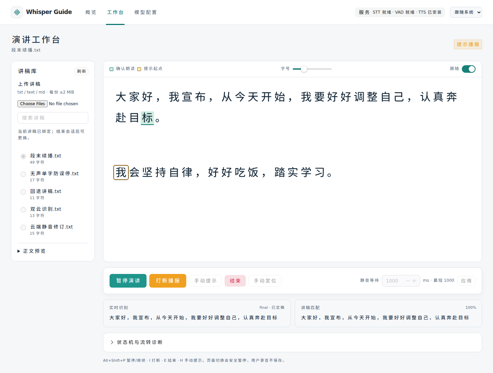
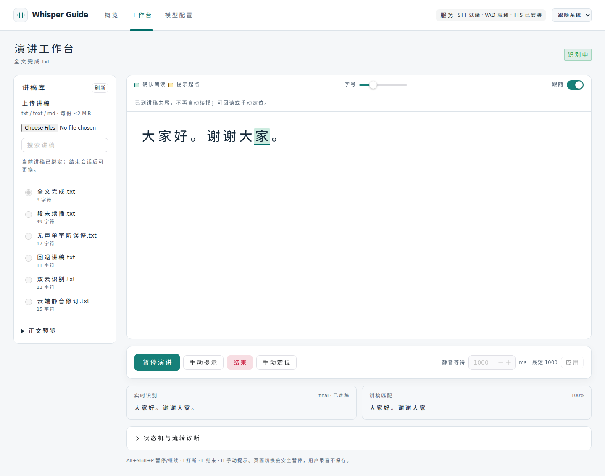

# 段末提示起点修复（2026-10-24）

## 根因与规则修订

旧实现可靠识别后直接令 `prompt_position = reading_position`，播报从最后一个已读单位开始，到最近的分段标点结束。因此已经读完“认真奔赴目标。”时会只生成“标。”，这是旧“包含最后单位”规则在片段末尾的不良边界行为。

本轮按用户反馈收紧这条规则，没有把所有提示统一改为“下一个字”：

| 已确认朗读位置 | 新提示行为 |
|---|---|
| 片段中间 | 保留最后一个完整内容单位作为上下文，再向后提示 |
| 现有分段标点前最后单位 | 跳到下一片段首个内容单位 |
| 空行前最后单位 | 跳到下一段落；支持 LF/CRLF，空行可含空格或 tab |
| 全文最后单位 | 提示游标为正文长度，不再重播末字，仍保持识别 |
| 手动定位 | 从明确选中的单位起点提示，不自动跳过 |

单换行仍作为软换行，界面自动折行也不构成讲稿边界。英文单词、连续数字和小数保持完整单位，不做字符串 `+1`。连续标点、空白与闭引号自然跳过。局部回读重新按回读后的可靠位置计算下一提示，不沿用系统更远的提示位置。

截图中的具体高亮为“遇到困难”的“难”，其后“不轻易放弃”之前没有标点，仍属于句中；它不证明已经可靠定位到整段末尾。若用户实际已说完整段但 ASR/对齐尚未确认，仍需处理识别问题，不能无依据跨过未确认文字。

## 实现范围

- `app/domain/tracking.py`：增加 `prompt_position_after_reading`；读完片段时计算下一内容单位，全文末尾返回正文长度。提示生成和已读边界共用 `_is_boundary`，新增空行分段而保留软换行。
- `app/domain/session.py`：只在可靠 `transcript` 分支计算提示起点。`reading_position`、定位可靠性、五状态、优先级、generation、手动定位、播放完成和暂停/打断机制保持原语义。
- `TeleprompterView.vue`：独立显示跨段双游标；全文已完成、可靠且无有效人声的识别状态下，显示可访问的末尾提示。没有增加第六状态。
- 同步需求文档 §3.3、§7.2、AC-05 与运维说明，对旧“总是包含最后单位”增加分段末尾例外。

## 自动化验证

新增 33 项后端边界专项，覆盖中英文 10 种分段标点、连续标点/引号/空白、LF/CRLF 空行、单换行、小数与英文单位、EOF 有无标点/尾空白、AC-13 回读、手动定位与暂停打断重播。原实现先复现“应提示下一段却停在末字”的失败，再修改实现。仅更新三项与新段尾规则直接冲突的旧断言，原句中提示规则测试继续保留。

前端新增 8 项，覆盖跨段双游标、全文末尾仅保留朗读高亮、手动定位及其他状态下不误显示末尾说明。

浏览器使用有限合成波形与本地 WebSocket ASR 模拟服务，验证：

1. 识别完整首段“……认真奔赴目标”后，绿色朗读游标停在“标”，橙色提示游标移到下一段“我”；静音到期真正请求并播放的提示文本为“我会坚持自律，”，不是“标。”。
2. 识别完“大家好。谢谢大家。”后，朗读游标保留“家”，提示高亮消失；等待超过阈值，仍无 PROMPTING/音频消息，并显示末尾说明。

本轮不请求真实云端账号、不读取或保存用户录音，不改变运行中的 8080 容器、模型配置或讲稿。这里验证提示起点计算，不是新的真人中文 ASR 准确率验收。


## 全量结果与截图

| 检查 | 结果 | 日志 |
|---|---|---|
| 后端 Ruff 静态/格式 | 通过，59 个文件格式合规 | [backend](validation/2026-10-24-prompt-boundary-backend.txt) |
| 后端 pytest | 512 passed；1 条既有第三方 TestClient 弃用提示 | 同上 |
| 前端 Node / Vitest | 19 + 68 = 87 项通过 | [frontend](validation/2026-10-24-prompt-boundary-frontend.txt) |
| TypeScript / 生产构建 | 通过 | 同上 |
| Chromium E2E | 14 passed | [browser](validation/2026-10-24-prompt-boundary-browser.txt) |
| Compose / 差异检查 | 通过 | `docker compose config --quiet` / `git diff --check` |

两张新增截图已检查，旧验收截图保留原历史版本：





## 应用更新

本轮没有重启原容器。结束当前会话后执行：

```bash
cd /home/timeleafing/projects/whisper-guide
docker compose build && docker compose up -d --force-recreate --wait --wait-timeout 180
```

刷新工作台，开始新会话。无需重新填写模型凭据或迁移讲稿数据库。
