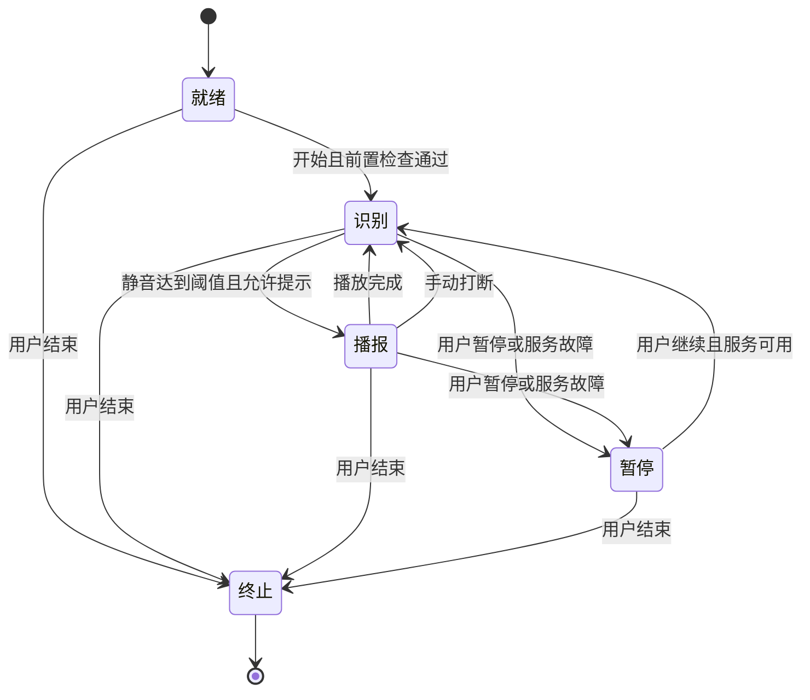

# 盲人演讲语音追踪与提示系统：第一版需求

- 文档状态：已确认的第一版需求基线
- 整理日期：2026-10-22
- 当前阶段：需求定义；技术选型留待下一步讨论

## 1. 产品目标

帮助盲人演讲者使用预先准备好的讲稿完成演讲。系统持续识别演讲者的语音并追踪讲稿进度；用户停顿达到设定时间后，自动通过耳机播报后续内容。用户可以打断播报、暂停会话、继续会话或结束会话。

第一版以基本照稿朗读为主要场景，允许口误、重复和少量插话，不以大量改述或即兴演讲为验收前提。

## 2. 第一版范围与运行环境

| 项目 | 需求 |
| --- | --- |
| 产品形式 | 网站 |
| 开发环境 | WSL 中的 Ubuntu |
| 访问环境 | Windows 上的 Chrome、Edge、Firefox；开发时访问本机 localhost |
| 后续部署 | 支持部署到远程服务器 |
| 语音处理 | 语音识别、语音合成、模型及语音资源放在服务端 |
| 浏览器职责 | 麦克风采集、音频传输、耳机播放、用户操作及状态展示 |
| 网络要求 | 第一版依赖网络和语音服务；断网或服务故障时暂停并反馈 |
| 讲稿语言 | 中文为主，夹杂英文和数字 |
| 操作要求 | 核心流程全键盘可操作，同时提供有明确名称的按钮 |
| 播放设备 | 使用用户电脑的默认音频输出设备，使用前由用户确认输出到耳机 |

本版不要求浏览器独立离线运行。服务端采用何种语言、框架、识别引擎、合成引擎及部署方式，均尚未选定。

## 3. 讲稿与位置定义

### 3.1 讲稿

- 以目标讲稿 `target_script` 为追踪和播报依据。
- 保留原文、标点及段落信息。
- 用户开始前须有可用讲稿；加载、导入和编辑的具体交互留待细化。
- 模糊匹配用于容忍少量识别错误。具体算法及判定阈值属于后续技术选型和验证内容。

### 3.2 内容单位

| 内容类型 | 单位定义 |
| --- | --- |
| 中文 | 一个汉字 |
| 英文 | 一个完整单词，不在单词中间开始播报 |
| 数字 | 一个连续数字整体，不从数字内部开始播报 |
| 标点与空白 | 不作为最后已读的内容单位；标点用于划分播报片段 |

例如，`欢迎参加 AI 2026 大会` 的内容单位为：`欢 / 迎 / 参 / 加 / AI / 2026 / 大 / 会`。

小数、日期、百分比、英文缩写及特殊符号的完整规则，需要在后续通过样例补充。小数中的点不得误判为分段句号。

### 3.3 两个独立的位置

| 位置 | 含义 | 更新规则 |
| --- | --- | --- |
| 用户朗读位置 `reading_position` | 用户最后可靠确认已读的内容单位 | 只根据可靠的用户语音匹配更新；系统播报不推进此位置 |
| 系统播报位置 `prompt_position` | 下一次自动播报的起点 | 用户可靠匹配后对齐到最后已读单位；正常播完后移至下一片段起点 |

- 尚未开口时，用户朗读位置为空，系统播报位置设为讲稿开头。
- 从用户朗读位置生成提示时，必须包含最后已读的那个单位，相当于重读一个单位后向后提示。
- 支持用户回读；不得仅因为系统已经播到后文，就强迫用户朗读位置只能向前。
- 重复句和相似句需要结合上下文追踪；位置不可靠时不得任意跳转。

## 4. 可配置静音阈值

| 参数 | 类型 | 默认值 | 单位 | 约束 |
| --- | --- | --- | --- | --- |
| `silence_timeout_ms` | 整型 | `3000` | 毫秒 | 必须为正整数；拒绝零、负数、小数及非数值输入 |

- 仅允许在就绪状态或暂停状态修改。
- 首次等待、朗读停顿、正常播完后的等待、打断后的等待，共用此参数。
- 修改后，下一次进入识别状态使用新值，不继承旧的静音时长。
- 毫秒是配置单位，不代表承诺毫秒级的触发精度；实际响应时延需要单独测试。
- 允许范围、界面步长和性能指标留待后续确认。

## 5. 五状态有限状态机

### 5.1 状态职责

| 状态 | 标识 | 行为 |
| --- | --- | --- |
| 就绪状态 | `READY` | 等待开始；不识别、不播报、不执行静音计时；开始前检查讲稿和服务是否可用 |
| 识别状态 | `LISTENING` | 持续识别用户语音、更新朗读位置、检测语音停顿并计时 |
| 播报状态 | `PROMPTING` | 暂停用户语音识别和静音计时，生成并播放当前提示片段 |
| 暂停状态 | `PAUSED` | 停止识别、播放和计时，保留讲稿位置，等待继续或结束 |
| 终止状态 | `TERMINATED` | 结束当前会话，停止采音、识别、播放和计时，释放相关资源 |

静音计时、位置是否可靠，以及等待合成与实际播放等信息属于状态内部信息，不增加用户可见状态。

### 5.2 状态图



### 5.3 状态转移与动作

| 当前状态 | 事件与条件 | 下一状态 | 必须执行的动作 |
| --- | --- | --- | --- |
| 就绪 | 用户开始，且讲稿和服务可用 | 识别 | 启动识别，识别准备完成后开始首次等待 |
| 识别 | 用户开始说话 | 识别 | 取消当前静音倒计时；可靠匹配后更新两个位置 |
| 识别 | 有效语音结束 | 识别 | 从最后一次有效语音结束开始计时 |
| 识别 | 静音达到阈值，位置可靠、有剩余内容且服务可用 | 播报 | 停止本轮识别和计时，确定本次片段范围并请求播放 |
| 播报 | 浏览器确认当前片段正常播放完成 | 识别 | 仅推进系统播报位置；恢复识别并开始新一轮等待 |
| 播报 | 用户手动打断 | 识别 | 立即停声，作废剩余音频；保留本次片段起点并恢复识别 |
| 识别或播报 | 用户暂停 | 暂停 | 立即停声、停止识别和计时，保留位置 |
| 识别或播报 | 断网或语音服务故障 | 暂停 | 停止当前活动，保留位置，反馈暂停原因 |
| 暂停 | 用户继续，且服务可用 | 识别 | 恢复识别，重新等待完整阈值 |
| 暂停 | 服务恢复但用户未继续 | 暂停 | 保持暂停，不自动识别或出声 |
| 任意未终止状态 | 用户结束 | 终止 | 停止全部活动，使旧请求及结果失效 |

未列出的事件不得自行造成状态转移。终止后的本次会话不能继续；重新开始时建立新会话，重新进入就绪状态。

## 6. 静音检测与计时规则

1. 计时依据有效语音活动，不依据 STT 文本结果到达时间。
2. 用户开始说话时，即取消本轮静音倒计时，不必等待文本匹配成功。
3. 用户停止说话后，从最后一次有效语音结束开始计算静音时长。
4. 点击开始后一直未开口，达到阈值后播报讲稿第一段。
5. 开始、继续、正常播完、手动打断后，均建立新的计时基准，不沿用上一轮静音时长。
6. 正常播完以浏览器实际播放结束为依据，不能把服务端生成完成当作播放完成；恢复识别就绪后开始新一轮等待。
7. 暂停时间、等待语音合成时间及识别尚未恢复可用的时间不累计为静音。
8. 识别状态内部可以正在说话或正在等待，无需单独设置静音状态。

例如，阈值为 `3000`，用户已静音 `2500` 毫秒后暂停；无论暂停多久，继续后都需要重新等待完整的 `3000` 毫秒。

## 7. 自动播报规则

### 7.1 自动触发条件

仅当以下条件全部满足时，允许自动进入播报状态：

- 当前处于识别状态。
- 静音达到 `silence_timeout_ms`。
- 当前讲稿位置可靠；首次未开口时，讲稿开头是已知起点。
- 存在尚可播报的内容。
- 服务可用，且不存在更高优先级的暂停或结束事件。

### 7.2 播报起点与终点

- 用户恢复朗读且可靠匹配后，下次提示从用户最后已读的一个内容单位开始，包含该单位。
- 从起点读到后续第一个分段标点为止。
- 第一版分段标点支持中英文逗号、句号、问号、感叹号和分号：`， , 。 . ？ ? ！ ! ； ;`。
- 连续分段标点合并处理，不产生空播报片段。
- 标点用于确定片段范围和语音停顿，不要求逐字读出标点名称。
- 末尾没有分段标点时，读到讲稿末尾。

### 7.3 正常播完后的连续播报

- 正常播完一个片段后，进入识别状态，并将系统播报位置移至下一片段开头。
- 若用户仍未说话，重新等待完整阈值后播报下一片段。
- 若用户恢复说话，取消倒计时；获得可靠匹配后，播报位置重新跟随用户。
- 只检测到语音但尚未可靠定位时，不得猜测新的讲稿位置；按定位异常规则处理。
- 连续播报期间不自动推进用户朗读位置。

### 7.4 手动打断

- 第一版通过按键或按钮打断，不支持开口自动打断。
- 打断在等待合成和实际播放期间均可用。
- 浏览器立即停止当前声音；不等待服务端确认才停声。
- 打断后恢复识别；若用户仍沉默达到阈值，从本次被打断的片段起点重播。
- 播报期间不识别用户语音。用户直接开口但未打断时，这部分语音不作为可靠进度更新依据。

## 8. 暂停、继续与结束

| 操作 | 作用 | 后续行为 |
| --- | --- | --- |
| 打断播报 | 停止当前提示，回到识别 | 继续静音达到阈值后重播当前片段 |
| 暂停会话 | 进入暂停，停止识别、播报和计时 | 不自动恢复，等待用户继续或结束 |
| 继续会话 | 从暂停统一进入识别 | 重新计时，不直接接着播放暂停时的音频 |
| 结束会话 | 进入终止并释放资源 | 本次会话不能继续 |

- 从识别状态暂停时，保留当前用户朗读位置和系统播报位置。
- 从播报状态暂停时，本次片段不得被视为已经播完；保留本次片段起点。
- 从播报中暂停后继续，若用户仍未开口，达到阈值后重播该片段。
- 结束操作在就绪、识别、播报和暂停状态均可用。
- 不使用一个语义模糊的操作同时代表打断、暂停与结束。

## 9. 事件优先级与过期结果

同一轮待处理事件按照以下优先级处理：

```text
结束
  > 暂停／服务故障
  > 手动打断播报
  > 用户开始说话
  > 播放完成
  > 静音超时
```

- 暂停与超时同时发生：进入暂停，不开始播报。
- 用户开始说话与超时同时发生：取消自动播报，继续识别。
- 打断与播放完成同时发生：按打断处理，不把片段记为播完。
- 状态转移必须统一处理，避免多个异步回调分别修改状态。
- 暂停、打断或终止后，旧轮次的识别结果、合成音频、计时回调及播放完成通知必须失效，不得重新出声或错误推进位置。
- 具体使用何种会话标识、请求标识或取消机制，在实现设计阶段确定。

## 10. 定位异常、服务异常与稿件结尾

### 10.1 定位不可靠

- 保持识别状态，停止自动提示。
- 每次进入定位异常时只反馈一次，不在持续异常期间反复打扰用户。
- 保留最后可靠位置，支持手动提示和重新定位；具体操作及手动提示起点需要进一步细化。
- 只有重新获得可靠位置后，才恢复自动提示资格；恢复说话后的静音按正常规则计时。

### 10.2 网络或服务不可用

- 识别或播报期间断网、识别服务故障或合成服务故障时，进入暂停状态。
- 停止当前声音及活动，保留进度，提供一次明确的状态反馈。
- 连接恢复不自动继续，用户主动继续后再进入识别状态。
- 故障反馈的具体形式、超时和重试策略留待技术设计。

### 10.3 稿件结尾

- 系统播完全文不等于用户已经读完全文。
- 系统播到全文末尾后，返回识别状态，停止自动续播，避免循环或生成空提示。
- 若用户随后继续朗读并可靠定位到稿件较前位置，可重新建立提示位置。
- 不仅凭 TTS 播完或静音超时自动终止会话；用户通过结束操作进入终止状态。

## 11. 操作与无障碍要求

- 开始、暂停、继续、打断播报和结束均有明确名称，可通过键盘完成。
- 手动提示与重新定位提供键盘可操作入口，具体交互后续细化。
- 当前状态及暂停原因应能被感知，不只通过颜色或文字高亮表达。
- 静音阈值配置显示毫秒单位，并提供有效输入校验。
- 具体快捷键、读屏软件及反馈方式尚未确定，不承诺系统级全局快捷键或切换应用后的行为。

## 12. 行为示例

讲稿：`今天我们讨论人工智能，接着介绍应用场景。`

用户读到：`今天我们讨论人工`

假设 `silence_timeout_ms = 3000`：

| 事件 | 预期行为 |
| --- | --- |
| 用户停顿达到阈值 | 从最后已读的“工”开始，播报“工智能，” |
| 正常播完后继续沉默达到阈值 | 播报“接着介绍应用场景。” |
| 播报“工智能，”期间手动打断 | 立即停声并恢复识别 |
| 打断后继续沉默达到阈值 | 从本次片段起点重播“工智能，” |
| 播报中暂停，之后继续但未开口 | 先进入识别，等待完整阈值后重播被暂停片段 |
| 用户恢复朗读并可靠匹配 | 重新按用户实际位置确定下次提示，不受系统曾播到的位置限制 |

## 13. 第一版验收标准

以下为行为验收基线。时间精度、停声时延、识别准确度等量化指标须在技术验证后补充，不以参数单位代替性能承诺。

| 编号 | 场景 | 预期结果 |
| --- | --- | --- |
| AC-01 | 就绪状态等待超过阈值 | 不识别、不自动播报 |
| AC-02 | 点击开始后一直未开口 | 识别就绪后等待阈值，播报第一段 |
| AC-03 | 静音未达到阈值就恢复说话 | 取消倒计时，不自动播报 |
| AC-04 | 用户读到片段中间后停顿达到阈值 | 包含最后已读单位，播报至下一分段标点 |
| AC-05 | 停顿前最后单位为英文单词或连续数字 | 从完整单位起点提示，不截断单位 |
| AC-06 | 正常播完后一直沉默 | 每次完整等待阈值后播报下一片段，用户朗读位置不变 |
| AC-07 | 等待合成或播放期间手动打断 | 立即停止当前播放并作废后续音频，进入识别 |
| AC-08 | 手动打断后未开口 | 等待阈值后从被打断片段起点重播 |
| AC-09 | 从识别或播报状态暂停 | 停止识别、声音和计时，保留对应位置 |
| AC-10 | 静音 2500 毫秒后暂停，阈值为 3000，稍后继续 | 重新等待 3000 毫秒，不继承暂停前静音时长 |
| AC-11 | 播报中暂停后继续 | 进入识别，不直接恢复播放；沉默达到阈值后重播本次片段 |
| AC-12 | 在就绪或暂停修改阈值 | 合法正整数生效；非法值被拒绝；识别和播报期间不允许修改 |
| AC-13 | 用户口误、少量插话、回读或遇到重复句 | 结合上下文追踪；不能可靠定位时禁止自动提示 |
| AC-14 | 持续定位不可靠 | 保持识别，只反馈一次，允许手动提示或重新定位 |
| AC-15 | 暂停后收到旧音频，或打断后收到旧播放完成通知 | 不重新出声，不错误推进位置 |
| AC-16 | 暂停与超时同时发生；用户开口与超时同时发生 | 分别按暂停、用户开口处理，自动播报不获优先权 |
| AC-17 | 网络或语音服务故障，随后恢复 | 进入暂停并保留进度；恢复后等待用户主动继续 |
| AC-18 | 系统播到全文末尾 | 停止自动续播，不循环；用户仍可继续识别或结束 |
| AC-19 | 在任意未终止状态结束 | 终止全部活动；旧回调无效，本次会话不能继续 |
| AC-20 | 使用键盘操作核心流程 | 可完成开始、暂停、继续、打断、结束和阈值配置 |

## 14. 已替代的旧需求

- 固定 3 秒，替换为可配置正整数 `silence_timeout_ms`，默认 3000 毫秒。
- 固定提示 5 个单位，替换为从指定起点播到下一分段标点。
- 同一次停顿只自动提示一次，替换为播完后重新等待阈值并继续下一片段。
- 用就绪状态兼任暂停，替换为独立暂停状态。
- 浏览器离线识别与合成，不属于第一版要求。
- 系统播报自动推进用户朗读位置，不采用；两个位置分别管理。

## 15. 下一步讨论：技术选型与待细化事项

以下尚未确认，不作为已选定实现：

1. 前后端语言和框架、实时音频传输方式及状态同步方案。
2. STT、VAD、TTS 引擎，及中英数字混合内容的效果验证。
3. 语音合成采用实时生成、提前生成、缓存或组合方式。
4. 讲稿导入、编辑、手动提示及重新定位的具体交互。
5. 数字、日期、小数、缩写和其他特殊符号的分词与读法。
6. 典型讲稿长度、单场时长、目标设备性能和并发规模。
7. 停顿检测精度、播报首音时延、手动停止时延、定位准确度及误提示率。
8. 麦克风、耳机、噪声环境、读屏软件与快捷键验收组合，以及页面失去焦点后的行为。
9. 进度持久化、异常恢复细节、音频与讲稿的数据保存策略。
