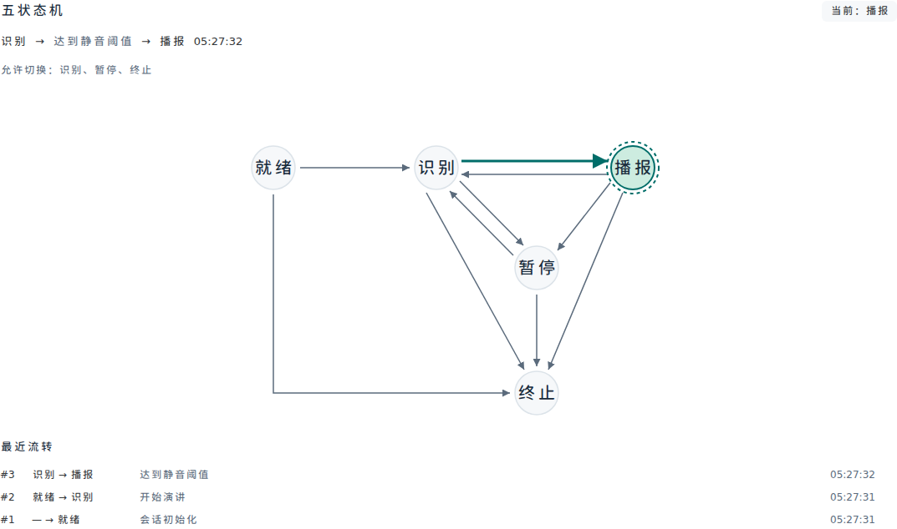
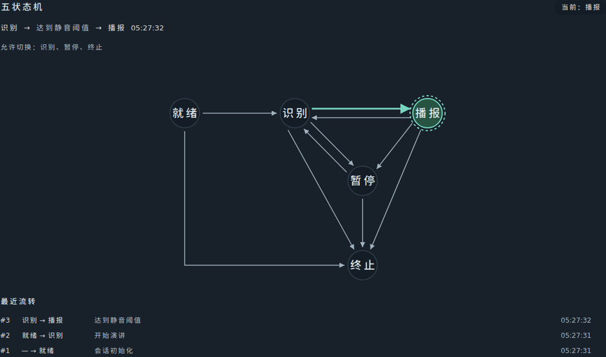

# 静音自动播报与五状态图验收（2026-10-24）

## 结果与行为边界

原有“识别 → 静音等待 → 播报”领域逻辑已存在。本轮修复截止检查只依赖周期任务命中音频处理空档的调度弱点：连续音频可能让 50 ms 轮询反复错过空闲，导致播报延后。新增完成帧后的同一截止检查；不重写状态机或另设计时器。

正常使用：选讲稿 → 设置静音等待 → 开始 → 允许麦克风 → 保持安静。麦克风就绪后，持续采集的静音帧不会重置计时，到期进入播报。播完回到识别，麦克风重新就绪后再次等待，下一次提示从提示游标继续。默认 3000 ms，最小 1000 ms；不会在用户仍讲话时到期抢播。

保留以下保护：

- 只在 LISTENING、麦克风就绪、无正在处理或排队音频时结算；排队人声优先于超时。
- 检查与会话状态修改使用同一把锁，锁内复查 runtime、socket 归属和音频轮次。取消或旧轮帧不得触发新会话/恢复轮次的 TTS。
- 超过 5 秒无帧属于设备断流并暂停；它与持续收到全零/安静音频不同。重复同轮 `audio_ready` 不重置计时。
- 定位不可靠时继续保留 AC-14 保护，不为制造提示而使用不可靠游标。未定稿有效文本仍在到期前先结算，按最新位置计算提示。
- 提示播放只推进 `prompt_position`，不推进 `reading_position`。五状态、轮次令牌、有界内存音频、不保存录音规则保持。

## 代码与图形

| 文件 | 修改 |
|---|---|
| `backend-core/app/api/session.py` | ticker 与 audio_worker 复用锁内空闲/截止检查；帧后传入 expected_generation，取消任务不在 finally 中触发检查 |
| `backend-core/tests/test_silence_prompting.py` | 8 项 WebSocket 级静音/轮次/队列优先级回归 |
| `backend-core/tests/browser_app.py` | 仅测试应用新增静音模式，原有演示识别仍保留 |
| `frontend/src/components/studio/StateMachineMonitor.vue` | 5 节点、10 条合法有向迁移，直线/折线、独立双向端口、外侧终止路径 |
| `frontend/tests/unit/stateMachineMonitor.spec.ts` | 13 项几何、迁移高亮和可访问名称检查 |
| `frontend/tests/e2e/silencePrompt.spec.ts` | 浏览器持续静音、自动播报、播放完成与下一句、双游标检查和截图 |

SVG 所有迁移均采用 `polyline`，无贝塞尔曲线。测试计算每条线段的相交与共线范围，确认边之间无交叉/重叠，且不穿过节点及其外圈；最近迁移的箭头和目标节点高亮。无障碍 title/desc、触发原因和最近十条历史保留，图自身不额外充当 live region。

浅色与深色截图均已检查：





## 自动化与实际检查

| 检查 | 本轮结果 | 日志 |
|---|---|---|
| 后端 Ruff | 静态通过，51 个文件格式通过 | [后端日志](validation/2026-10-24-silence-state-backend.txt) |
| 后端 pytest | 400 passed；1 条第三方 TestClient 弃用提示 | 同上 |
| 前端测试 | Node 19 + Vitest 52 = 71 项通过 | [前端日志](validation/2026-10-24-silence-state-frontend.txt) |
| TypeScript / 生产构建 | 通过 | 同上 |
| Chromium E2E | 10 passed | [浏览器日志](validation/2026-10-24-silence-state-browser.txt) |
| 原生模型数字静音 | STT/VAD/TTS 依赖 ready；0 人声帧、0 有效识别文本 | [原生日志](validation/2026-10-24-silence-state-native.txt) |
| Docker Compose | 配置解析通过；未启动/替换容器 | `docker compose config --quiet` |

新增后端专项验证 1000/3000/6000 ms 不提前播报、重复就绪不重置、播完/恢复重启等待、断流暂停、周期轮询没有空档时的帧后检查、旧轮完成隔离、截止时排队人声优先。禁用轮询的截止用例在修复前超时；旧轮完成隔离用例在补充 generation 保护前错误进入 PROMPTING，修复后均通过。

浏览器测试让麦克风持续发送 20 ms 全零 PCM16 帧，配置等待 1000 ms：第一轮约 **1023 ms**、第二轮约 **1012 ms**，第一轮已发送 **51 帧**。观察到 READY → LISTENING → PROMPTING → LISTENING → PROMPTING；两轮依次提示“第一句提示。”和“第二句提示。”，`reading_position` 始终为 null，播放完成后按 `prompt_position` 继续。时间含调度与消息传输开销，不是硬实时保证。

原生检查直接向真实 sherpa-onnx / WebRTC VAD 输入 300 帧数字静音（每帧 640 字节、16 kHz 单声道 PCM16，共 6000 ms 音频），得到 0 人声帧、2 次空识别更新、0 次有效文本。全程只在内存中生成和处理音频，不保存用户录音。

浏览器服务与 TTS 使用测试替身及内存合成 WAV；数字静音检查使用真实本地模型，但未重新验证真人麦克风、真实 edge-tts 网络播放或云端账号。既有真实中文 STT 验收保持为历史记录。原 8080 Docker 服务、讲稿与模型方案未修改；本轮没有构建或导出镜像。

## 复现与更新

```bash
cd backend-core
uv run ruff check .
uv run ruff format --check .
uv run pytest
cd ../frontend
pnpm test
pnpm typecheck
pnpm build
pnpm test:e2e
```

浏览器用例独立启动 8010 后端和 5174 Vite，临时数据库与模型方案在结束后清理；无需访问或改写 8080 容器。

使用现有容器部署时，先结束演讲会话，再在项目根目录更新：

```bash
docker compose build && docker compose up -d --force-recreate --wait --wait-timeout 180
```

浏览器刷新 `/studio` 后开始新会话；修改源码不会自动更新已运行镜像。人工验收应保持麦克风开启并静音，而不是停止音频采集。
