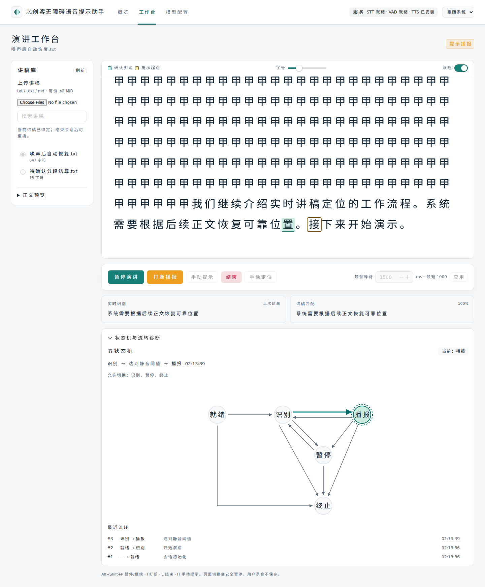

# 工作台使用指南

首次安装、远程访问与更新见[部署指南](../DEPLOY.md)；语音服务和文本模型的设置见[模型配置指南](model-configuration.md)。

## 准备讲稿与设备

在支持麦克风的浏览器中，通过 `localhost` 或 HTTPS 打开服务，并允许麦克风权限。远程服务器推荐使用部署指南中的 SSH 隧道或受保护的 HTTPS 入口；直接访问远程 HTTP 地址可能无法采音。

使用耳机、合适的麦克风和稳定的讲话距离，先确认系统输入与输出设备。浏览器会请求回声消除、降噪和自动增益；支持时还请求语音隔离。这些请求不代表设备实际启用了相同处理，也不能保证隔离旁人讲话。

界面有三个入口：

| 页面 | 用途 |
|---|---|
| 概览 `/` | 最近讲稿、当前生效模型方案及快捷入口 |
| 工作台 `/studio` | 讲稿、实时位置、会话控制与识别诊断 |
| 模型配置 `/settings/models` | 编辑、测试及激活识别和语义模型方案 |

在讲稿库上传 `.txt`、`.text` 或 `.md` 纯文本文件。初始默认每次最多 10 份、每份不超过 2 MiB；管理员可通过环境变量调整，页面显示当前服务端限制。支持 UTF-8、带 BOM 的 UTF-16 与 GB18030。空文件、非文本内容或整批中存在无效文件时，不会保存部分结果。同名文件会成为独立讲稿；Markdown 内容按纯文本展示。

搜索并选择本次讲稿，可展开“正文预览”核对内容。未结束的会话已经绑定讲稿，暂停也不能换稿；请先结束，再选择其他讲稿。较窄屏幕通过“讲稿库”按钮打开选择面板。

## 删除讲稿

每条讲稿右侧提供“删除”。点击后核对名称，选择“删除讲稿”确认；“取消”不修改列表。成功后刷新讲稿库，被删稿的选择和正文预览清空。

任何未结束会话绑定的讲稿不能删除，包括就绪、暂停与断线会话。当前页面禁用对应按钮并说明原因；其他页面占用时后端也拒绝。先结束相关会话，不能用暂停代替结束。演讲期间可删除其他未使用讲稿。

失败保留原条目并显示原因。按ID删除，不按同名批量删除；界面不能撤销，重要讲稿请备份。

## 开始与控制演讲

1. 选择讲稿，在开始前设置“静音等待”。初始默认 `3000 ms`，可由管理员的 `WHISPER_GUIDE_DEFAULT_SILENCE_TIMEOUT_MS` 修改；刷新页面后新会话采用服务端默认。最小为 `1000 ms`，必须填写整数；手动设置和恢复会话保留自身参数。
2. 点击“开始演讲”，允许麦克风并等待收音就绪。云端握手期间显示“正在连接语音识别，请稍候再朗读”，就绪后才启动传音，避免首句丢失。静音等待从麦克风就绪后开始；即使尚未朗读，保持安静也可收到第一段提示。
3. 按正文朗读，观察“实时识别”和“讲稿匹配”。真实静音达到等待时间后系统开始提示；本轮位置未确认时从已保存的提示起点播报，并显示说明。
4. 需要调整等待时间时先暂停，修改后点击“应用”，再继续。结束后可开始新演讲。

| 操作 | 行为 |
|---|---|
| 暂停演讲 | 停止采集与播放，保留会话和位置 |
| 继续演讲 | 回到识别并重新等待，不接着播放上次音频 |
| 打断播报 | 立即取消当前提示，回到识别；只在播报时可用 |
| 手动提示 | 从当前提示起点播一段；不代表自动定位已恢复可靠 |
| 手动定位 | 搜索并选中一个讲稿单位，点击“应用位置”，明确设置下一次提示起点 |
| 结束 | 终止该会话并释放进度，已保存讲稿保留 |

播报期间采集会停用；如需提前恢复识别，使用“打断播报”或相应快捷键。

## 看懂位置与识别结果

讲稿中的三个标记承担不同职责：

| 标记 | 含义 |
|---|---|
| 确认朗读 | 最近一次已确认的朗读位置 |
| 提示起点 | 下一次语音提示从哪里开始 |
| 蓝色虚线“临时定位” | 稳定识别草稿的候选位置，仍待确认 |

识别草稿（`partial`）连续两次相同或保持约 `300 ms` 后，可显示临时定位。定稿（`final`）或实际静音截止时对有效草稿的结算，才提交确认位置。临时高亮不会移动确认游标或认定全文已经读完。进度模式可用有效且稳定向前的草稿延后接管，播报前仍需结算，不能仅凭临时高亮选择新起点。

“实时识别”显示 ASR 原始文字；“讲稿匹配”显示本地对齐到的讲稿原文，两者可以不同。“已过滤”表示该条转写缺少对应的有效声学证据，没有用于定位；它不证明当前声音一定不是讲话，也不会自动解除已有失配。

“上次结果”和“上次匹配”是历史参考。匹配百分比是讲稿对齐评分，不是当前语音识别准确率；即使保留旧高分，当前位置也可能仍待确认。

可调整字号和“跟随”开关。自动跟随只随确认朗读位置滚动，临时定位不会触发滚动；手动滚动或翻页后，可点“返回当前位置”重新跟随。

## 两种自动提示模式

默认“静音后提示”适合安静环境。周围声音使系统反复等待时，可在“演讲设置”中选择“进度超时提示”：静音规则仍保留，额外在讲稿位置持续没有推进时接管。进度等待默认4000ms，可设2000–10000ms；后台计时，页面只展示状态。

只有可靠讲稿向前推进，或有声学依据且稳定向前的临时结果，才算新进度。噪音、同一句重复返回、无关识别和填充词不会无限延长等待。它不提高原始ASR准确率；慢读、重读或脱稿时也可能插播，可点“再等一下”重新等完整周期，或暂停后调整阈值。

存在未撤回的可靠朗读锚点时，进度模式从该位置之后的完整字/英文单词/数字开始播到下个标点；失配、证据已撤回或从未定位时从保存提示起点播报并说明；只有新声音尚待确认时仍保留最后可信锚点。默认一次停滞只自动提示一段，之后等你继续读；“持续代读后文”开启后才在每轮完整等待后逐段续播。手动提示仍随时可用，播报不等于你已读完。

静音等待、进度等待与云端识别超时是独立参数。未收音、设备断流、音频积压或服务失败不会被当作停滞自动播报。自动提示需要TTS合成和浏览器实际播放，阈值不是精确出声时刻。

## 静音提示如何继续

麦克风保持采集且持续传输安静音频，才是正常静音。人声或有效识别修订可能推迟提示；不要通过停用麦克风来模拟静音。超过 5 秒没有收到音频帧时，系统按设备断流暂停。

提示按讲稿中的标点和空行分段，而不是按屏幕自动换行分段：

| 已确认的位置 | 下一次提示 |
|---|---|
| 片段中间停顿 | 从最后一个完整已读单位开始，保留少量上下文 |
| 已读完标点或空行前的片段 | 从下一片段开始 |
| 全文末尾 | 不重复末字，仍保持识别，可回读、手动定位或结束 |
| 手动定位 | 从明确选中的单位开始 |

中文字符、英文单词及连续数字分别按完整单位处理；小数不会因为其中的点而被拆成两个提示片段。单换行属于软换行，空行才形成段落边界。

播完提示后只推进提示起点，不把系统播出的内容记成用户已经朗读。重新收音就绪后开始下一轮静音等待，因此持续安静时可逐段提示。

## 手机使用

手机工作台优先显示讲稿正文、会话状态和底部主操作。讲稿库、演讲设置、定位与诊断通过适应屏幕的面板打开；识别详情和状态机默认折叠。手动滚动会停跟随，可点“返回当前位置”；底部预留系统安全区。

设置里可切换模式、调整等待时间、字号和持续代读；在就绪/暂停时应用会话选项。播报时使用“打断播报”返回识别，结束演讲需确认。手机模型页面先选方案，再编辑，保存与设为生效仍是两个动作。

切后台、锁屏、来电或音频设备中断后可能暂停；回前台检查提示并点“继续演讲”，不会自动开麦或出声。实际授权和输出仍需在Android Chrome/iPhone Safari真机验收；布局测试不代表所有设备都已可正常识别和播报。

## 定位失败后自动恢复

定位不可靠时音频识别继续运行。静音等待到期会优先结算有效草稿；仍未确认则从已保存的提示起点播报，并明确说明，不会永久等待新转写。对齐诊断与主会话状态分别显示：

| 对齐状态 | 含义与处理 |
|---|---|
| `reliable` | 已有可用的确认位置，满足静音条件后允许提示 |
| `pending` | 本轮位置尚未确认；静音到期先结算有效草稿，否则按保存提示起点播报 |
| `mismatch` | 最近有效文字未能匹配讲稿；继续正文可重新定位，静音到期仍按保存提示起点播报 |

系统无需大模型也能持续检索全稿。附近唯一正文可以直接恢复；远处跳转需要两个独立、连续的有效片段，每段至少 6 个内容单位。中文通常一字一个单位，英文单词及完整数字各算一个单位。同段反复修订、重复同一句或模型纠错，不会被重复计作两份证据。

| 恢复提示 | 建议操作 |
|---|---|
| 正在尝试自动恢复 | 继续清晰朗读更完整的一段正文 |
| 多处相似内容 | 继续读后文，帮助区分重复段落 |
| 等待后续朗读确认 | 继续下一段，让系统确认候选位置 |

确认后提示起点随真实朗读位置更新，无需先手动定位。无法消歧、明显脱稿或需要立即指定位置时，可手动定位。静音到期按保存起点播报属于提示兜底，不代表定位成功；用户未确认的实际进度可能与保存起点不同。

若旧的模型结果迟到，而当前有新的声音或草稿尚未结算，当前活动仍待确认。已经收到的有效草稿可按原静音截止规则结算；只有声音却没有有效文字时，不猜测新的位置。

自动恢复后的工作台示例（合成语音验证，确认位置与提示起点独立）：

## 切页、断线与恢复

离开工作台会立即停止浏览器采集和播放，并请求暂停会话；返回后需点击“继续演讲”，不会自动重新开启麦克风。

连接中断时保留当前进度并提示重连。可返回工作台继续，或在“服务与连接诊断”中重连；重连本身不会自动开始采集。刷新页面后，尚存于服务端的断线会话会出现在“有可恢复的会话”中：

- 点击“恢复连接”，返回工作台后继续演讲。
- 明确不再使用时，点击“结束此会话”；该操作释放会话进度，保留讲稿。
- 已被其他页面连接的会话不能通过断线恢复入口强制结束，应在所属工作台结束。

实时会话只在服务端内存中，服务重启后不能恢复进度，需重新开始。浏览器仅保留用于重连的会话 ID；这不是录音或转写备份。

## 设备采样率与音频中断

`AudioContext.createMediaStreamSource: Connecting AudioNodes from AudioContexts with different sample-rate is currently not supported` 表示浏览器不能把输入音轨接到不同采样率的音频图，发生在采集连接阶段。旧版把采集图固定为 16000 Hz，而设备可能报告 44100/48000 Hz；这会使部分浏览器直接无法采集，不能当成模型识别错误。

现在优先使用输入音轨报告的采样率；遇到采样率不兼容时先释放失败图，再有界尝试浏览器默认率或更新后的设备率。AudioWorklet按实际音频图采样率输出固定 **16000 Hz、单声道、PCM16、每20 ms一帧**。多声道输入会合成单声道，不再只取第一声道。后端 `WHISPER_GUIDE_SPEECH_SAMPLE_RATE` 只允许 `16000`，不能改成声卡采样率来绕过报错。

“服务与连接诊断”在采集时显示输入轨道率、音频图率及声道；设备未报告的值显示“未上报”，不保存设备标识或音频。模块加载、恢复音频图均有时限，断开、系统中断或处理器错误会暂停会话并释放资源。先在系统中确认输入/输出设备，返回页面点击“继续演讲”重新打开；切换蓝牙、USB设备或来电后也采用此操作。

输出图使用系统默认输出。点击开始/继续时尝试解锁播放，输出解锁失败不再阻塞识别；真正播报失败时会暂停并显示原因。恢复或解码超时、系统中断、输出图关闭和未收到播放结束事件均不会误报“播放完成”。浏览器的播放结束回调也不能证明物理扬声器可听，仍需检查音量、标签页静音及系统输出路由。

浏览器降噪、回声消除及自动增益仍由设备支持情况决定；现有重采样为加权平均，不是完整高质量滤波或神经降噪。低带宽蓝牙输入、立体声反相和强背景讲话仍需真实设备验收；大模型不能修复没有采集到的音频。

## 不播报或识别变乱时

先打开顶栏“服务与连接诊断”，分别核对后端、WebSocket、麦克风、当前会话 STT、TTS 依赖和最近播放结果，再看“状态机与流转诊断”的触发原因。主状态只有就绪、识别、播报、暂停和终止；“搜索中”或“待确认”不是新增会话状态。

| 现象 | 优先检查 |
|---|---|
| 没有采音或采样率报错 | 更新前端并刷新页面；使用 localhost/HTTPS，检查权限和输入设备，再点击继续；后端保持16000 Hz |
| 一直识别但不提示 | 看控制区等待原因和静音计时；区分检测到声音、音频处理/积压、无帧、连接未就绪及全文末尾 |
| 原始文字错，讲稿匹配正确 | 已进行文本校准，继续观察确认位置 |
| 原始文字正确，匹配不可靠 | 继续读独特后文帮助恢复，必要时手动定位 |
| 显示“识别已回退本地” | 云端故障后实际识别源已改变；检查网络和语音配置 |
| 已播报却听不到 | 查看最近播放原因，检查系统默认输出、音量、标签页静音和TTS合成网络，再点击继续 |
| 修改配置后不能激活 | 结束全部未终止会话，检查断线恢复列表 |

`ready` 或健康接口正常只表示能力检查通过。TTS 依赖显示“已安装”不保证服务器能完成联网合成，也不证明浏览器已实际播放。状态刷新不会开启麦克风或调用付费模型；显式模型测试是独立操作。

## 无障碍与快捷键

支持亮色、暗色和跟随系统；顶部“跳到主要内容”可跳过导航。页面切换会更新标题并将焦点移到页面标题，可使用 Tab、Shift+Tab 和控件自身的键盘操作。

以下组合键仅在工作台生效；焦点位于输入框、下拉框、可编辑内容或对话框内时不触发：

| 快捷键 | 操作 |
|---|---|
| `Alt+Shift+P` | 暂停／继续 |
| `Alt+Shift+I` | 打断播报 |
| `Alt+Shift+E` | 结束演讲 |
| `Alt+Shift+H` | 手动提示 |

快捷键不能替代首次点击开始及浏览器的麦克风、音频授权。读屏软件、浏览器和系统可能占用组合键，遇到冲突可使用同名按钮；目标设备和读屏组合仍需实际验证。

## 数据与能力边界

讲稿保存在服务端 SQLite；录音、识别结果、临时位置和提示音频仅在有界内存处理，不写入项目数据库或音频文件。模型凭据由后端私有文件保管，备份与访问控制见[维护手册](maintenance.md)。

启用云端 STT 会发送音频；启用文本 LLM 会发送讲稿片段和识别文字。即使使用本地 STT，提示音仍通过需要服务器联网的 edge-tts 合成，并向该服务发送待合成文字。外部服务的数据处理规则由相应服务商决定。

系统能收紧平稳底噪的纯能量兜底，并撤回失去声学支持的定位证据；被撤回的已确认结果会降为不可靠，保留偏移供历史参考。强背景人声、音乐、突发噪声、回声与长时间 VAD 漏检仍有边界，当前没有主讲人隔离或完整神经降噪。继续用真实正文恢复，不应通过任意提高音量门限或放宽匹配分数掩盖问题。

当前没有用户认证和讲稿权限隔离，只适合可信访问范围；远程开放需按部署指南配置保护。合成音频、模拟协议和健康检查不能替代目标麦克风、真实云端识别准确率及长时浏览器使用验证；验证方法见[测试指南](testing.md)。服务器故障与更新处理见[维护手册](maintenance.md)。

## 静音到期仍在识别或出现积压

“实时识别”的文字不变不能单独证明静音：声音可能被VAD检测到但未产生文字，或音频仍在服务器队列。控制区现在显示服务端等待原因与静音进度，诊断抽屉另有最近音频到达、排队毫秒数及每批推理成本。

| 等待原因 | 解释与处理 |
|---|---|
| 静音计时中 | 实际安静音频正在到达，计满后开始合成/播报 |
| 检测到声音/短促声音 | 真正的人声优先；检查环境声、回声和麦克风位置，不能只看文字有无变化 |
| 处理最新音频 | 一批推理尚未结束；结合耗时和帧数判断，不等于已积压 |
| 处理积压音频 | 排队内容先处理，避免抢在真实讲话前播报；持续积压会有界暂停 |
| 无持续音频 | 检查麦克风、页面是否后台、网络和权限；超过5秒按断流暂停，不当成静音 |
| 连接/麦克风未就绪 | 等待服务或授权，未就绪不计静音 |
| 全文末尾 | 无后续内容，不循环播报 |

位置pending或mismatch不再永久阻止静音提示；计满后从保存的提示起点播报，同时保持“未确认位置”说明。设置的3000ms是静音触发条件，TTS合成、网络和浏览器播放还需要时间；持续人声、断流、积压、服务失败及全文末尾不能保证精确到毫秒出声。

“音频处理积压，已暂停”是待处理音频超过有界容量，不等于噪音结论。更新代码后已有无损小批调度和稳定partial去重；若仍频繁出现，观察排队与推理指标，检查容器CPU限额、主机负载及同时会话数。云端显示“等待识别结果超时（1000ms）”则是独立语音响应超时，可先按模型配置指南核对网络与超时，不能通过增大静音时间或队列掩盖长期处理能力不足。
